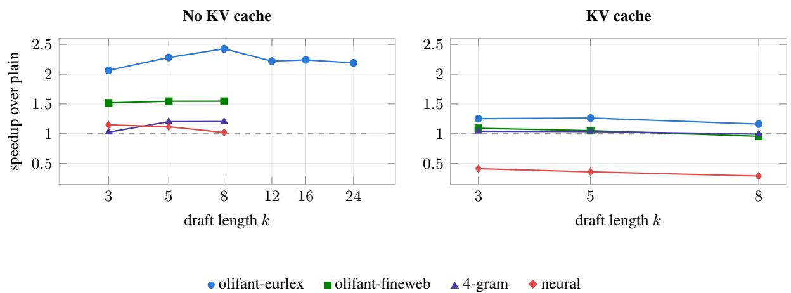
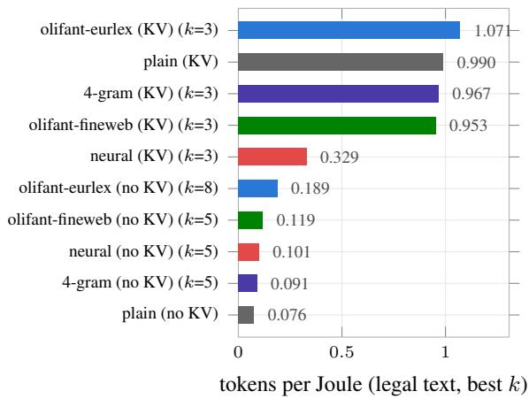

# Towards Green Text Generation: Memory-Based Speculative Decoding

Antal van den Bosch

Utrecht University

a.p.j.vandenbosch@uu.nl

## Abstract

Speculative decoding accelerates text generation with large language models by letting a cheap draft model propose tokens that a large verifier checks in a single forward pass. We introduce Olifant, a draft model built on a memory-based classifier. It predicts the next token from a four-token window in under 0.3 ms on CPU, requiring no GPU, no backpropagation, and no accelerator memory. We measure throughput and energy under two verifier regimes on consumer hardware. Without a KV cache, drafting is nearly free: a domain-matched Olifant model reaches 38.1% acceptance on EU legal text, delivering 2.43× throughput and 2.51× lower energy per token than the neural verifier model alone. With a KV-cached verifier, itself a ∼10× energy saver, drafting costs matter: a TinyLlama draft model halves throughput and triples energy despite high acceptance, whereas Olifant still yields 1.25× throughput and the lowest energy in the study (93 J per 100 tokens, 14× below the uncached baseline). We further show that KV caching decouples time from energy: verification of longer drafts raises power draw, shifting the energy-optimal draft length below the speed-optimal one. Speculative decoding is not dead in the age of fast verifiers, provided drafting is nearly free.

## 1 Introduction

Text generation with large language models is sequential by nature: each token must be generated before the next, creating a bottleneck that limits throughput even on modern hardware. Speculative decoding (Leviathan et al., 2023; Chen et al., 2023) addresses this by pairing a cheap draft model with an expensive verifier. The draft model proposes k tokens into the future; the verifier processes all k+1 positions in one forward pass, accepting the longest prefix consistent with its own greedy predictions. When acceptance rates are high, many tokens are produced per verifier call, yielding wallclock speedups.

Speed, however, is only half of the efficiency story. Local text generation is increasingly energybound: the energy cost of every verifier forward pass, not just its latency, determines the footprint of on-device generation. This constraint binds hardest where generation cannot leave the device at all: medical and legal text applications routinely rule out cloud APIs for confidentiality reasons, and it is precisely these domains where we find the largest efficiency gains. We therefore evaluate draft models on both axes, throughput and energy per generated token (Section 4), under two verifier regimes. In a transformer, the attention keys and values computed for already-processed tokens can be stored in a KV cache, so that each new token only requires computing attention for itself instead of re-encoding the entire sequence; maintaining this cache turns generation into cheap incremental steps at the price of holding per-token states in accelerator memory. We evaluate batch verification without a KV cache, where full-context attention dominates and draft tokens are nearly free, and KV-cached verification, where each draft position carries real cost. The two regimes give opposite answers to how long a draft should be, and to which draft models are viable at all. We find that a neural draft model that pays for itself against a slow verifier becomes a net loss against a fast one, while memory-based drafting, at ∼0.2 ms per token from CPU RAM, remains profitable in both regimes.

The design of the draft model determines whether speculative decoding pays off. Neural draft models from the same neural model type as the verifier achieve high acceptance by construction, but incur substantial inference cost themselves. Statistical n-gram models, in contrast, are nearly free to query but cannot generalize beyond observed sequences. Recent retrieval-based approaches (He et al., 2024; Yang et al., 2023) look up draft continuations in a corpus, trading memory for prediction quality: REST retrieves continuations whose recent context matches the generated suffix exactly, and inference-with-reference copies spans from documents already present in the prompt. Both draft only text that occurs verbatim in their source (we return to this comparison in Section 5.4).

We explore memory-based learning (Daelemans and van den Bosch, 2005) as a novel design point. Memory-based language modeling is rooted in two classic machine learning paradigms, k-nearest neighbor classification and decision-tree learning, and stores its training data in a prefix trie, a retrieval-oriented tree in which instances sharing feature values share a path. Specifically, we use TiMBL’s IGTree algorithm (Daelemans et al., 1997, 2010),1 which compresses a training set of (context window → next token) instances into such a trie with levels ordered by information gain, the most predictive context position at the top. IGTree classifiers are wrapped into a functional autoregressive decoder, codenamed Olifant (van den Bosch et al., 2025).

At query time a single path is traversed from the root, matching the query’s context tokens level by level in this order, and the majority next token stored at the deepest matching node is returned. A context never seen verbatim in training is thus still answered, from the deepest matching prefix of its most informative positions; the remaining, less informative positions are ignored. The trie is additionally pruned at training time: nodes whose majority label agrees with that of their parent are not stored, typically shrinking the trie by about 95% while leaving lookups of stored contexts unchanged. Unlike neural models, Olifant requires no GPU and no backpropagation. The contrast with an in-session n-gram draft model (a baseline in this study) is of a different kind. The n-gram model is not trained at all: it continuously indexes the current session’s context, exploiting recency and burstiness of tokens, whereas Olifant is a fullyfledged trainable language model in memory-based form, fixed at inference time and trained offline on a corpus of choice.

## 2 System Description

## 2.1 Olifant Draft Models

We pre-train four Olifant models used for drafting. Each training corpus is tokenised with the mistralai/Mistral-7B-v0.1 SentencePiece tokeniser. Consecutive windows of width w=4 yield instances (t1, t2, t3, t4) → t5. The four models are matched to each evaluation domain of Section 3, plus an unmatched control. olifantwikitext is trained on the WikiText-103 training split (Merity et al., 2017) with 130 million tokens,2 whose test split supplies our general-text prompts; olifant-pubmed on the PubMed Summarization training split (Cohan et al., 2018) containing 536 million tokens,3 matching the medical task; and olifant-eurlex on the EurLex training split (Chalkidis et al., 2022) of 94 million tokens,4 matching the legal task. The fourth variant, olifant-fineweb, is trained on one shard of FineWeb-edu 5 web-crawled educational text that overlaps with none of the three test sources, containing 1.089 billion tokens; it serves as the largest model and domain-unmatched control, probing what an off-the-shelf general model offers without domain match. The resulting instance bases occupy 145 MB for the smallest model, eurlex, to 4.6 GB for the largest model, fineweb, of CPU RAM.

At inference time, at each speculative step, the last w context tokens are sent to Olifant, which returns its prediction. Instance bases are loaded lazily and released per strategy to save memory.

## 2.2 Baselines

We compare against three baseline models:

Plain. No draft model; the verifier is called once per token: the non-speculative throughput baseline.

4-gram. A sliding-window frequency model over the accumulated context, including tokens generated by the verifier in the current session. It therefore adapts online to the verifier’s output.

Neural. TinyLlama-1.1B-Chat-v1.0 (Zhang et al., 2024)6 via HuggingFace Transformers. The neural draft is hosted on the MPS accelerator alongside the verifier and is evaluated in both full sweeps.

## 2.3 Draft Model Latency

We measure standalone next-token prediction latency with 50 single-token queries (10 prompts × 5 repetitions, no verifier involved): the 4-gram hash lookup answers in 0.09 ms, the Olifant variants in 0.16–0.25 ms, and TinyLlama-1.1B in 254 ms per token on CPU.

In other words, the 4-gram model and all Olifant variants predict the next token in under 0.3 ms, negligible against any verifier forward pass. TinyLlama needs a 1.1B-parameter forward pass per token; we host it on the accelerator alongside the verifier, costing ∼2 GB of accelerator memory.

## 2.4 Verifier and Acceptance

Mistral-7B-v0.1 base (Jiang et al., 2023)7 is loaded via HuggingFace Transformers on a M1 Max GPU via MPS (float16). We evaluate two verification regimes.

In the regime Without KV caching, at each speculative step the full sequence (context + k draft tokens) is fed to the model in a single forward pass; the logits at positions [ctx−1 .. ctx+k−1] are compared greedily against the draft tokens to determine the accepted prefix; i.e., k+1 token predictions are obtained at the cost of one forward pass. No KV cache is maintained across steps, so full-context attention dominates the cost of every step.

In the KV-cached regime, the cached decoder prefills the context once and maintains the KV cache across steps. Upon rejection, the cache is truncated to the accepted prefix. We made two design choices. First, the first draft token is verified against the previous step’s logits, which have already been computed. Costs for the k-token verification pass only need to be incurred when the first draft token is accepted. Second, acceptance is decided at the token-ID level (exact greedy match), making the cached decoder output-preserving by construction. In exact arithmetic its output equals plain greedy decoding; under float16 on MPS, rare shape-dependent kernel differences cause occasional divergences (Section 3.3).

## 3 Experiments

## 3.1 Setup

We evaluate on three tasks: (1) General text: 100 prompts from the WikiText-103 test split (first 50 words of each article as prompts; 100 tokens generated). (2) Medical: 100 prompts from the PubMed Summarization test split (first 50 words of each article as prompts; 100 tokens generated). (3) Legal: 100 prompts from the EurLex test split (first 50 words of each EU legislative document as prompts; 100 tokens generated).

We report mean tokens per second (tps), acceptance rate, mean accepted length (MAL), and ROUGE-L against a plain greedy reference. Energy metrics are defined in Section 4. The main text quotes selected cells; complete acceptance and MAL results for every strategy × task × k cell in both regimes are tabulated in Appendix A.

Each regime sweeps the same 7 strategies × $k ~ \in ~ \{ 3 , 5 , 8 \} ~ \times ~ 3 0 0$ prompts = 6,300 generations. In the cached regime, wall-clock timestamps are recorded per generation and system power is logged in parallel, so that throughput and energy for this regime derive from a single run under identical conditions; uncached energy comes from a separate 63-configuration measurement grid (30 prompts per cell, Section 4). All experiments are run on the same Mac Studio (Apple M1 Max, 32 GB RAM) with the verifier on MPS.

## 3.2 Results: Uncached Verification

Table 1 reports mean throughput and speedup over plain generation; Figure 1 (left) plots the legal-text speedups against k. Nearly every strategy achieves a genuine wall-clock speedup on every task at every k value; the single exception is olifant-pubmed on general text at $k { = } 3 \left( 0 . 9 6 { \times } \right)$ , where the domainmismatched model provides insufficient acceptance to offset its overhead. The domain-matched olifanteurlex model on legal text reaches 2.43× at k=8 (19.9% acceptance) and 2.06× at k=3 (38.1% acceptance), by far the best results in the study. The domain-matched olifant-pubmed reaches 1.48– 1.53× on medical text, and olifant-wikitext is the strongest Olifant variant on its matched generaltext task (1.39–1.41×), completing the domain diagonal. The unmatched control olifant-fineweb never leads a task but is the best domain-unmatched

  
Figure 1: Speedup over plain decoding vs. draft length k on legal text, under the two verifier regimes (shared y-axis). Without a KV cache (left), draft tokens are nearly free and speedup grows with k; with a KV cache (right), each draft position has real verification cost and every curve slopes downward: profit requires high acceptance (domain-matched olifant-eurlex), and the expensive neural draft falls far below break-even (dashed line). $k \geq 1 2$ uncached points are from a preliminary +D sweep, speedups computed against the same plain baseline.

Olifant on all three. The 4-gram baseline benefits strongly from the no-KV-cache regime, reaching 1.42× on general text at k=8.

Also, speedup increases with k for olifant-eurlex on legal text: 2.06× at k=3, 2.28× at k=5, and 2.43× at k=8, despite acceptance rate falling from 38.1% to 19.9%. The neural draft moves in the opposite direction, from 1.15–1.20× at k=3 down to 1.01–1.07× at k=8: the only strategy whose speedup falls with k in this regime.

Without KV caching, speedup grows with k as appending k draft tokens adds negligible marginal cost, so any non-zero acceptance produces a net gain, and larger k is almost always better (cf. the analysis in Section 5.1). Olifant-eurlex illustrates this directly: acceptance falls from 38.1% to 19.9% as k grows from 3 to 8, yet mean accepted length grows from 1.13 to 1.53 tokens per step, driving throughput from 4.73 to 5.55 tps. The neural draft is the exception that proves the rule: its k draft tokens each require a sequential TinyLlama forward pass on the accelerator, so drafting is not free.

The gain from larger k is bounded, however. Extending the sweep to k ∈ {12, 16, 24} for olifanteurlex on legal text (Figure 1, left) shows throughput peaking at k=8 (2.43×) and settling near 2.2× beyond. Mean accepted length keeps growing (1.53→1.62 tokens/step), but the extra draft tokens are no longer negligible relative to the ∼150-token context, making k=8 the practical optimum.

Output quality is unaffected. Because verification is greedy, speculative decoding is outputpreserving: an accepted draft token is by definition the verifier’s own greedy choice at that position. Empirically, every strategy, including plain decoding, attains an identical mean ROUGE-L of 0.956 against an independently generated greedy reference, across all tasks and all k. The residual divergence from 1.0 stems from floating-point nondeterminism on MPS, and affects all strategies equally: the speed and energy gains reported here cost nothing in output quality.

## 3.3 Results: KV-Cached Verification

Table 2 reports the cached-regime sweep; Figure 1 (right) plots the legal-text curves on the same axis as the uncached regime.

KV caching lifts plain decoding from 2.3–2.8 to 16.3–16.9 tps. Prompt length ceases to matter: the 18% uncached gap between legal and general text collapses to 3%. Against this faster baseline, all speculative gains are lower, and decrease with k, the mirror image of the uncached regime. Domain-unmatched strategies land at break-even (0.9–1.1×): the rejection fast-path protects them from losses at k=3, but their 5–20% acceptance is too low to make a positive difference. Still, the domain-matched olifant-eurlex retains a margin on legal text: 1.25× at k=3, and 1.26× at k=5 (20.6 tps). Acceptance rates replicate across regimes (38.1% on legal text in both), confirming the draft model’s behaviour is regime-independent.

TinyLlama, a genuine 1.15–1.20× accelerator in the uncached regime, drops to a slowdown of 0.47×–0.29×: each speculative step spends more time drafting k tokens sequentially than the cached verifier needs to check them. Two-neural-model speculative decoding, the original design, is a net loss against a fast verifier on this hardware, while the memory-based draft model, three orders of magnitude cheaper per token, remains profitable where its acceptance is high.

<table><tr><td></td><td></td><td colspan="3">tps</td><td colspan="3">Speedup</td></tr><tr><td>Strategy</td><td>k</td><td>Gen.</td><td>Med.</td><td>Legal</td><td>Gen.</td><td>Med.</td><td>Legal</td></tr><tr><td>plain</td><td></td><td>2.80</td><td>2.71</td><td>2.29</td><td>1.00×</td><td>1.00×</td><td>1.00×</td></tr><tr><td>ngram</td><td>3</td><td>3.72</td><td>2.74</td><td></td><td>2.35</td><td>1.33× 1.01×</td><td>1.03×</td></tr><tr><td></td><td>5</td><td>3.88</td><td>3.40</td><td></td><td>2.75</td><td>1.39× 1.25×</td><td>1.20×</td></tr><tr><td></td><td>8</td><td>3.99</td><td>3.47</td><td></td><td>2.75</td><td>1.42× 1.28×</td><td>1.20×</td></tr><tr><td>neural</td><td>3</td><td>3.35</td><td>3.16</td><td></td><td>2.63</td><td>1.20× 1.17×</td><td>1.15×</td></tr><tr><td></td><td>5</td><td>3.24</td><td>2.99</td><td></td><td>2.56 1.16×</td><td>1.10×</td><td>1.12×</td></tr><tr><td></td><td>8</td><td>2.99</td><td>2.74</td><td></td><td>2.33</td><td>1.07× 1.01×</td><td>1.02×</td></tr><tr><td>olifant-fw</td><td>3</td><td>3.71</td><td>3.93</td><td></td><td>3.47 1.32×</td><td>1.45×</td><td>1.52×</td></tr><tr><td></td><td>5</td><td>3.74</td><td>4.00</td><td></td><td>3.54 1.34×</td><td>1.47×</td><td>1.54×</td></tr><tr><td></td><td>8</td><td>3.65</td><td>3.95</td><td></td><td>3.54</td><td>1.30× 1.46×</td><td>1.55×</td></tr><tr><td>olifant-wiki</td><td>3</td><td>3.94</td><td>3.38</td><td></td><td>2.72</td><td>1.41× 1.25×</td><td>1.19×</td></tr><tr><td></td><td>5</td><td>3.90</td><td>3.26</td><td></td><td>2.53 1.39×</td><td>1.20×</td><td>1.11×</td></tr><tr><td></td><td>8</td><td>3.90</td><td>3.23</td><td></td><td>2.42</td><td>1.39× 1.19×</td><td>1.06×</td></tr><tr><td>olifant-pub</td><td>3</td><td>2.68</td><td>4.11</td><td></td><td>2.75</td><td>0.96× 1.51×</td><td>1.20×</td></tr><tr><td></td><td>5</td><td>3.14</td><td>4.16</td><td></td><td>2.73</td><td>1.12× 1.53×</td><td>1.19×</td></tr><tr><td></td><td>8</td><td>3.03</td><td>4.00</td><td></td><td>2.64</td><td>1.08× 1.48×</td><td>1.15×</td></tr><tr><td>olifant-eur</td><td>3</td><td>3.07</td><td>3.03</td><td></td><td>4.73</td><td>1.09× 1.12×</td><td>2.06×</td></tr><tr><td></td><td>5</td><td>3.00</td><td>2.96</td><td></td><td>5.22</td><td>1.07× 1.09×</td><td>2.28×</td></tr><tr><td></td><td>8</td><td>3.05</td><td>3.03</td><td></td><td>5.55 1.09×</td><td>1.12×</td><td>2.43×</td></tr></table>

Table 1: Throughput and speedup (local Mistral-7B verifier, no KV cache), 100 prompts per task. Speedup relative to plain. olifant-fw = olifant-fineweb; olifantwiki = olifant-wikitext; olifant-pub = olifant-pubmed; olifant-eur = olifant-eurlex. Bold: best per task.

Output quality again holds: cached speculative outputs score within 1.5 ROUGE-L points of cached plain decoding (0.955–0.959 vs. 0.971). IDlevel greedy acceptance is output-preserving by construction; spot checks confirm byte-identical output. The residual gap is, again, due to float16 kernel nondeterminism (k-token verification passes compute slightly different logits than k single-token passes).

## 4 Energy Efficiency

We measure whole-system power with macOS powermetrics (combined CPU, GPU, and Neural Engine power, sampled at 1 Hz) while each strategy generates. Energy per token is computed as $\mathrm { J } / 1 0 0 \mathrm { t o k } = \bar { P } \cdot t _ { \mathrm { w a l l } } / n _ { \mathrm { t o k } } \times 1 0 0 $ , where P¯ is the mean power over the generation window. For the uncached regime, each strategy × task × k cell covers 30 prompts in a dedicated measurement run. For the cached regime, energy is measured during the throughput sweep: each generation carries a wall-clock timestamp, and per-block windows are joined against the parallel power log, so that throughput and energy for its 100 prompts per cell come from one run under identical conditions. Background system load was minimised during measurement; repeat measurements of the plain configuration agree within 2% in both regimes.

<table><tr><td></td><td></td><td colspan="3">tps</td><td colspan="3">Speedup</td></tr><tr><td>Strategy</td><td>k</td><td>Gen.</td><td>Med.</td><td>Legal</td><td>Gen.</td><td>Med. Legal</td></tr><tr><td>plain</td><td></td><td>16.94</td><td>16.84</td><td>16.34</td><td>1.00×</td><td>1.00× 1.00×</td></tr><tr><td>ngram</td><td>3</td><td>18.20</td><td>17.72</td><td>17.02</td><td>1.07×</td><td>1.05× 1.04×</td></tr><tr><td></td><td>5</td><td>17.47</td><td>17.36</td><td>16.93</td><td>1.03×</td><td>1.03× 1.04×</td></tr><tr><td></td><td>8</td><td>17.73</td><td>16.88</td><td>16.22</td><td>1.05×</td><td>1.00× 0.99×</td></tr><tr><td>neural</td><td>3</td><td>7.92</td><td>7.51</td><td>6.75</td><td>0.47×</td><td>0.45× 0.41×</td></tr><tr><td></td><td>5</td><td>6.83</td><td>6.33</td><td>5.87</td><td>0.40×</td><td>0.38× 0.36×</td></tr><tr><td></td><td>8</td><td>5.40</td><td>5.00</td><td>4.72</td><td>0.32×</td><td>0.30× 0.29×</td></tr><tr><td>olifant-fw</td><td>3</td><td>17.35</td><td>17.87</td><td>17.84</td><td>1.02×</td><td>1.06× 1.09×</td></tr><tr><td></td><td>5</td><td>16.56</td><td>17.01</td><td>17.18</td><td>0.98×</td><td>1.01× 1.05×</td></tr><tr><td></td><td>8</td><td>15.06</td><td>15.44</td><td>15.63</td><td>0.89×</td><td>0.92× 0.96×</td></tr><tr><td>olifant-wiki</td><td>3</td><td>17.84</td><td>17.17</td><td>16.64</td><td>1.05×</td><td>1.02× 1.02×</td></tr><tr><td></td><td>5</td><td>17.14</td><td>16.42</td><td>15.94</td><td>1.01×</td><td>0.98× 0.98×</td></tr><tr><td></td><td>8</td><td>15.62</td><td>15.16</td><td>14.78</td><td>0.92×</td><td>0.90× 0.90×</td></tr><tr><td>olifant-pub</td><td>3</td><td>16.88</td><td>18.28</td><td>16.72</td><td>1.00×</td><td>1.09× 1.02×</td></tr><tr><td></td><td>5</td><td>16.50</td><td>17.42</td><td>16.04</td><td>0.97×</td><td>1.03× 0.98×</td></tr><tr><td></td><td>8</td><td>15.59</td><td>15.64</td><td>14.99</td><td>0.92×</td><td>0.93× 0.92×</td></tr><tr><td>olifant-eur</td><td>3</td><td>16.81</td><td>16.77</td><td>20.46</td><td>0.99×</td><td>1.00× 1.25×</td></tr><tr><td></td><td>5</td><td>16.34</td><td>16.13</td><td>20.64</td><td>0.96×</td><td>0.96× 1.26×</td></tr><tr><td></td><td>8</td><td>15.47</td><td>15.13</td><td>18.98</td><td>0.91×</td><td>0.90× 1.16×</td></tr></table>

Table 2: KV-cached verification results (local Mistral-7B verifier with persistent KV cache and rejection fastpath), 100 prompts per task. Speedup relative to cached plain. Abbreviations as in Table 1. Bold: best tps and speedup per task.

## 4.1 Uncached Regime

In the uncached regime, every draft strategy reduces energy per token on every task at every k (plain baseline: 1,005–1,326 J per 100 tokens), as shown in Table 3. The domain-matched Olifant models achieve the largest savings: olifant-eurlex on legal text cuts energy per token by 2.51× (529 vs. 1,326 J per 100 tokens at k=8), and olifantpubmed on medical text by 1.52×. The neural draft is strongest on general text (727 J, 1.40× at k=5), where TinyLlama’s broad coverage yields the highest acceptance, but it is beaten by the domain-matched Olifant models on specialised text. The domain-unmatched olifant-fineweb still outperforms the 4-gram baseline in every single cell (1.27–1.58× vs. 1.16–1.33×).

<table><tr><td></td><td></td><td colspan="3">J/100 tokens</td><td colspan="3">Energy ratio</td></tr><tr><td>Strategy</td><td>k</td><td>Gen.</td><td>Med.</td><td>Legal</td><td>Gen.</td><td></td><td>Med. Legal</td></tr><tr><td>plain</td><td>3</td><td>1005</td><td>1097</td><td>1313</td><td>1.00</td><td>1.00</td><td>1.00</td></tr><tr><td></td><td>5</td><td>1019</td><td>1086</td><td>1326</td><td>1.00</td><td>1.00</td><td>1.00</td></tr><tr><td></td><td>8</td><td>1019</td><td>1095</td><td>1326</td><td>1.00</td><td>1.00</td><td>1.00</td></tr><tr><td>ngram</td><td>3</td><td>827</td><td>930</td><td>1120</td><td>1.21</td><td>1.18</td><td>1.17</td></tr><tr><td></td><td>5</td><td>798</td><td>930</td><td>1099</td><td>1.28</td><td>1.17</td><td>1.21</td></tr><tr><td></td><td>8</td><td>767</td><td>945</td><td>1102</td><td>1.33</td><td>1.16</td><td>1.20</td></tr><tr><td>neural</td><td>3</td><td>738</td><td>865</td><td>1016</td><td>1.36</td><td>1.27</td><td>1.29</td></tr><tr><td></td><td>5</td><td>727</td><td>854</td><td>989</td><td>1.40</td><td>1.27</td><td>1.34</td></tr><tr><td></td><td>8</td><td>760</td><td>924</td><td>1046</td><td>1.34</td><td>1.19</td><td>1.27</td></tr><tr><td>olifant-fw</td><td>3</td><td>788</td><td>781</td><td>875</td><td>1.27</td><td>1.40</td><td>1.50</td></tr><tr><td></td><td>5</td><td>768</td><td>788</td><td>839</td><td>1.33</td><td>1.38</td><td>1.58</td></tr><tr><td></td><td>8</td><td>785</td><td>820</td><td>845</td><td>1.30</td><td>1.34</td><td>1.57</td></tr><tr><td>olifant-wiki</td><td>3</td><td>815</td><td>916</td><td>1054</td><td>1.23</td><td>1.20</td><td>1.25</td></tr><tr><td></td><td>5</td><td>850</td><td>956</td><td>1064</td><td>1.20</td><td>1.14</td><td>1.25</td></tr><tr><td></td><td>8</td><td>828</td><td>916</td><td>1091</td><td>1.23</td><td>1.20</td><td>1.21</td></tr><tr><td>olifant-pub</td><td>3</td><td>861</td><td>734</td><td>1081</td><td>1.17</td><td>1.49</td><td>1.21</td></tr><tr><td></td><td>5</td><td>918</td><td>718</td><td>1100</td><td>1.11</td><td>1.51</td><td>1.21</td></tr><tr><td></td><td>8</td><td>938</td><td>721</td><td>1102</td><td>1.09</td><td>1.52</td><td>1.20</td></tr><tr><td>olifant-eur</td><td>3</td><td>908</td><td>940</td><td>617</td><td>1.11</td><td>1.17</td><td>2.13</td></tr><tr><td></td><td>5</td><td>919</td><td>961</td><td>550</td><td>1.11</td><td>1.13</td><td>2.41</td></tr><tr><td></td><td>8</td><td>960</td><td>981</td><td>529</td><td>1.06</td><td>1.12</td><td>2.51</td></tr></table>

Table 3: Energy per generated token (J/100 tokens; lower is better) and energy ratio vs. plain at the same k (higher is better), measured with powermetrics on Apple Silicon; 30 prompts per cell, local Mistral-7B verifier, no KV cache. Plain rows are repeat measurements (k unused). Bold: best per task.

Across all 63 uncached configurations, mean system power stays within a narrow band (16–31 W, median ≈28 W): no strategy meaningfully raises power draw over plain decoding. Energy per token is therefore dominated by wall-clock time, and for the CPU-side drafts, whose sub-millisecond lookups add no measurable power, the uncached energy ratios track the throughput speedups of Table 1 almost directly. The neural draft deviates in the favourable direction: its energy ratios (1.19–1.40) run ahead of its speedups (1.01–1.20), because sequential TinyLlama drafting leaves the accelerator less saturated than the full-context verifier passes it replaces (23.6 vs. 28.3 W mean). As the next subsection shows, this coupling of time and energy is a property of the uncached regime, not a general law.

## 4.2 Cached Regime

Cached plain decoding costs 96–106 J per 100 tokens (Table 4), one tenth of the uncached 1,005– 1,326 J. The saving exceeds the 6–7× throughput gain, because power also drops (16.5 W vs.

  
Figure 2: Energy efficiency ladder on legal text (tokens generated per Joule, best k per strategy). KV caching is the largest single lever; domain-matched memory-based drafting adds to it, while the neural draft costs energy in the cached regime.

≈28 W): one-token steps leave the accelerator less saturated than full-context passes. Deployments that can afford KV caching should use it; no draft model comes close to what caching saves.

In the cached regime, power is no longer constant across strategies: mean power draw rises with draft length, from 16.4 W (plain) to 22.1 W (olifant-eurlex, k=8), because dense k-token verification passes work the accelerator harder than one-token steps. Consequently, time and energy deviate. Olifant-eurlex on legal text at k=8 is 1.16× faster than plain, yet spends 1.18× more energy; at k=3 it is both 1.25× faster and 1.09× more energyefficient (93 J per 100 tokens, the study’s lowest). The energy-optimal draft length is thus shorter than the speed-optimal one. The three k-optima characterize the regimes: uncached speed favours k=8, cached speed k=3–5, cached energy k=3.

TinyLlama, in contrast, adds markedly to the energy usage of the verifier: from a 1.2–1.4× energy saver in the uncached regimen to a 2.5–3.8× energy cost in the cached regimen (243–382 J per 100 tokens). Both factors degrade at once (doubled wall time; a second neural network occupying the accelerator), and the deficit deepens with k.

Figure 2 visualizes the energy efficiencies of various models in terms of tokens per Joule: cached configurations cluster an order of magnitude above uncached ones, with cached olifant-eurlex (k=3, 1.07 tok/J) at the top and the neural draft as the only strategy that moves down the ladder within its regime.

<table><tr><td></td><td></td><td colspan="3">J/100 tokens</td><td colspan="3">Energy ratio</td></tr><tr><td>Strategy</td><td>k</td><td>Gen.</td><td>Med.</td><td>Legal</td><td>Gen.</td><td>Med.</td><td>Legal</td></tr><tr><td>plain</td><td>3</td><td>96</td><td>97</td><td>102</td><td>1.00</td><td>1.00</td><td>1.00</td></tr><tr><td></td><td>5</td><td>97</td><td>100</td><td>106</td><td>1.00</td><td>1.00</td><td>1.00</td></tr><tr><td></td><td>8</td><td>96</td><td>97</td><td>101</td><td>1.00</td><td>1.00</td><td>1.00</td></tr><tr><td>ngram</td><td>3</td><td>96</td><td>98</td><td>103</td><td>1.00</td><td>0.99</td><td>0.99</td></tr><tr><td></td><td>5</td><td>122</td><td>108</td><td>110</td><td>0.80</td><td>0.92</td><td>0.96</td></tr><tr><td></td><td>8</td><td>109</td><td>111</td><td>115</td><td>0.88</td><td>0.87</td><td>0.88</td></tr><tr><td>neural</td><td>3</td><td>243</td><td>264</td><td>303</td><td>0.40</td><td>0.37</td><td>0.34</td></tr><tr><td></td><td>5</td><td>272</td><td>298</td><td>330</td><td>0.36</td><td>0.34</td><td>0.32</td></tr><tr><td></td><td>8</td><td>334</td><td>362</td><td>382</td><td>0.29</td><td>0.27</td><td>0.26</td></tr><tr><td>olifant-fw</td><td>3</td><td>109</td><td>103</td><td>105</td><td>0.88</td><td>0.94</td><td>0.97</td></tr><tr><td></td><td>5</td><td>121</td><td>116</td><td>116</td><td>0.81</td><td>0.86</td><td>0.92</td></tr><tr><td></td><td>8</td><td>136</td><td>132</td><td>132</td><td>0.71</td><td>0.73</td><td>0.76</td></tr><tr><td>olifant-wiki</td><td>3</td><td>100</td><td>103</td><td>107</td><td>0.96</td><td>0.95</td><td>0.96</td></tr><tr><td></td><td>5</td><td>110</td><td>112</td><td>115</td><td>0.89</td><td>0.90</td><td>0.92</td></tr><tr><td></td><td>8</td><td>129</td><td>128</td><td>132</td><td>0.74</td><td>0.76</td><td>0.77</td></tr><tr><td>olifant-pub</td><td>3</td><td>100</td><td>99</td><td>104</td><td>0.96</td><td>0.98</td><td>0.98</td></tr><tr><td></td><td>5</td><td>106</td><td>111</td><td>113</td><td>0.92</td><td>0.90</td><td>0.94</td></tr><tr><td></td><td>8</td><td>118</td><td>132</td><td>127</td><td>0.81</td><td>0.73</td><td>0.79</td></tr><tr><td>olifant-eur</td><td>3</td><td>100</td><td>102</td><td>93</td><td>0.97</td><td>0.95</td><td>1.09</td></tr><tr><td></td><td>5</td><td>107</td><td>110</td><td>100</td><td>0.91</td><td>0.91</td><td>1.06</td></tr><tr><td></td><td>8</td><td>118</td><td>124</td><td>118</td><td>0.81</td><td>0.78</td><td>0.85</td></tr></table>

Table 4: Cached-regime energy (J/100 tokens; lower is better) and energy ratio vs. cached plain at the same k, derived from the timestamped throughput sweep joined with the 1 Hz power log; 100 prompts per cell. Only high-acceptance domain-matched drafting (olifanteurlex on legal, $k \leq 5 )$ saves energy; ratios below 1.00 indicate an energy cost despite any speed gain. Bold: best per task.

## 4.3 Training Energy

The figures above cover inference; a greengeneration claim should also count the energy needed to build the draft models. Training an Olifant model is a single CPU pass over the corpus: tokenisation, windowing, and IGTree trie compilation, with no backpropagation and no accelerator. Compiling the largest instance base (fineweb, 1.089 billion tokens) took about six hours on the evaluation machine, roughly half a megajoule at the tens of watts it draws for CPU-bound work: a one-time expense recouped within roughly a thousand 100- token generations at the savings of Table 3; the smaller corpora cost less. The neural draft model sits at the other end of the scale: TinyLlama was pretrained on 3 trillion tokens on 16 A100 GPUs over about 90 days (Zhang et al., 2024), on the order of $1 0 ^ { 1 0 }$ J counting GPU board power alone, four to five orders of magnitude above the memorybased models. Pretrained models amortise this cost across many downstream uses, but the contrast stands: the lifecycle energy of a memory-based draft model is dominated by inference, not training.

## 5 Discussion

## 5.1 The Verifier Cost Model

The standard break-even condition for speculative decoding is:

$$
{ \mathrm { a c c } } \_ { \mathrm { r a t e } _ { \mathrm { b r e a k - e v e n } } } \approx { \frac { k } { k + 1 } }\tag{1}
$$

If verifying k draft tokens costs as much as generating them one by one, a speculative step only pays off when nearly all of its draft tokens are accepted, and the required per-token acceptance rises with the draft length: 3 out of 4 or 75% at k=3, 89% at $k { = } 8$

Without KV caching, transformer attention over the full context dominates each forward pass, and the marginal expense of appending k draft positions is negligible. The break-even threshold collapses to near zero: any non-zero acceptance yields a speedup, larger k is better up to a plateau (Section 3.2), and every uncached energy ratio exceeds 1.0. This regime matches any deployment where the verifier is re-invoked on the full sequence (stateless serving, or devices that cannot afford a cache), and it is forgiving of low-acceptance drafts.

With KV caching, Equation 1 would predict that none of our draft models survive: no strategy approaches 75% acceptance. Two effects soften the prediction. The rejection fast-path heuristic (Section 2.4) means failed steps cost no more than plain steps, so a k-token verification pass can only achieve gains in extra accepted tokens on steps in which the first token is accepted. Empirically, the resulting threshold sits near 20–25% first-token acceptance: below it, strategies flatline at break-even (Table 2); above it, which only olifant-eurlex on legal text reaches at 38%, a genuine margin appears. TinyLlama’s sequential drafts cost more than the cached verification they enable, at any acceptance.

## 5.2 Speculative Decoding is Not Finished

Against slow verification, the original two-model speculative decoding design still performs as predicted; our uncached results reproduce this. Verifier-side optimization (KV caching here; batching, quantization, and faster kernels generally) shrinks the budget available for drafting, however. The field’s general trajectory away from separate draft LMs toward ever-cheaper drafting (attached heads, retrieval, prompt lookup) concedes the point: our cached results show the separate neural draft losing 2–3× on the same hardware where it once profited. Memory-based drafting, on the other hand, occupies the far end of that trajectory: sub-millisecond, CPU-resident, verifieragnostic (any model sharing the tokeniser), and domain-adaptable by swapping an instance base rather than retraining. It is the only draft design in this study that remains profitable in both regimes. Speculative decoding is not finished as verifiers get faster; drafting merely has to become nearly free, and memory-based learning is one way to get there.

## 5.3 Olifant vs. In-session 4-gram: Related but Distinct

The in-session 4-gram model we compared against in this study is not a trained model: it builds its frequency table from the accumulated context of the current session, including tokens generated by the verifier. It therefore automatically adapts to the verifier’s output distribution, and to the recency and burstiness of words in the running text, effectively acting as an online imitator. Olifant is the opposite design: a trained language model in memory-based form, fixed at inference time, with no mechanism to incorporate session-level feedback. This explains why the 4-gram baseline competes well on domains where no Olifant model was trained (Table 1): online adaptation substitutes for static acceptance.

A second difference is that Olifant operates natively on Mistral’s SentencePiece tokens, the same units the verifier uses, so draft predictions slot directly into the verification step with no representation mismatch. The 4-gram model predicts whitespace-delimited words, of which only the first sub-token survives the text-fallback path; this structural mismatch caps its effective acceptance regardless of word-level accuracy.

On domain-matched tasks, Olifant’s offline training pays off decisively (38.1% vs. 24.7% acceptance on legal text; 2.43× vs. 1.20× speedup at k=8). On unmatched domains, the 4-gram’s online adaptation closes most of the gap. Two extensions suggest themselves toward the best of both approaches: training Olifant directly on the verifier’s output distribution, and augmenting the fixed instance base with a recency/burstiness component that, like the 4-gram baseline, tracks the current session’s context. Preliminary experiments with such a hybrid are ongoing; we leave a full treatment to

future work.

## 5.4 Olifant vs. Retrieval-Based Drafting

Olifant is also distinct from the retrieval-based drafting methods cited in Section 1. REST (He et al., 2024) keeps the draft corpus as a suffixarray datastore and, at each step, retrieves continuations whose recent context matches the generated suffix exactly; inference-with-reference (Yang et al., 2023) copies spans from reference documents already present in the prompt, targeting settings with high prompt-output overlap such as retrievalaugmented generation. Both are exact-match designs: when matching, they draft long verbatim spans, and when the current context does not occur in their source, they draft nothing. Olifant instead compiles the corpus into a next-token predictor. The IGTree trie discards about 95% of the instance base at training time, its depth bounded by the context window rather than the corpus size. Its information-gain-ordered prefix backoff returns a prediction for every context, including contexts never seen verbatim in training, by ignoring the least informative window positions. The price is that Olifant drafts one token per query rather than a retrieved span. In machine learning terms, IGTree is itself a decision-tree compression of a k-nearestneighbor learner (Section 1), so Olifant can be read as a decision-tree draft model with retrieval functionality. An empirical head-to-head with REST and inference-with-reference on the same hardware and both verifier regimes is an obvious next step (Section 5.6).

## 5.5 Method or Text? Attributing the Domain-Match Advantage

Olifant-eurlex’s lead on legal text raises the question whether the advantage reflects the memorybased method or merely properties of legislative text, such as local repetition. To calibrate, we measure the redundancy of the evaluation texts themselves. Decoding is output-preserving, so every strategy produces the same text for a given prompt; the statistics below therefore describe the exact texts on which all acceptance rates were computed. Table 5 reports three measures over each task’s 100 generations, computed on Mistral tokens to match the draft models’ context window: the within-text repetition rate (the fraction of a text’s token 4- grams that already occurred earlier in the same text), the cross-document overlap (the fraction of a text’s distinct 4-grams that also occur in at least one other text of the same task), and the gzip compression ratio of the task’s concatenated text as a model-free summary.

<table><tr><td>Task</td><td>Within-text</td><td>Cross-doc.</td><td>gzip</td></tr><tr><td>General</td><td>29.6%</td><td>26.7%</td><td>0.29</td></tr><tr><td>Medical</td><td>21.2%</td><td>14.9%</td><td>0.33</td></tr><tr><td>Legal</td><td>12.1%</td><td>73.6%</td><td>0.18</td></tr></table>

Table 5: Redundancy of the evaluation texts (100 generations per task, Mistral tokens). Within-text: mean fraction of a text’s token 4-grams already seen earlier in the same text. Cross-doc.: mean fraction of a text’s distinct 4-grams that also occur in another text of the same task. gzip: compression ratio of the task’s concatenated text (lower = more redundant).

Within documents, legal text is the least repetitive of the three tasks (12.1% vs. 21.2% medical and 29.6% general), so within-generation repetition cannot explain the acceptance ordering. In contrast, 73.6% of a legal text’s distinct 4-grams recur in other legal texts, against 14.9% and 26.7% elsewhere, and the concatenated legal texts compress to 0.18 of their size. This cross-document formulaicity is what offline training on a domain corpus captures; it is the mechanism by which memorybased drafting profits, not a confound of it.

The contribution of the method, as opposed to the text, is isolated by comparing draft models on identical legal texts: at k=3, acceptance spans 7.5% (olifant-pubmed) to 38.1% (olifant-eurlex), with the 4-gram baseline at 24.7% and the neural draft at 21.1% (Appendix A). The text is held constant across these rows; only the draft model changes. Both factors are thus real and separable: tasks differ in how much cross-document redundancy there is to harvest, and draft models differ in how much of it they capture.

## 5.6 Future Work

Several axes are deliberately left open. First, a direct empirical comparison with retrieval-based drafting (REST and inference-with-reference, Section 5.4) on the same hardware and under both verifier regimes. Second, verifier diversity: repeating the sweeps with verifiers of other sizes and families would test how far the cost-model analysis of Section 5.1 carries; the same holds for server-class GPUs, where faster verification should sharpen the cached-regime compression we observe. Third, sampling and batching: speculative sampling (Leviathan et al., 2023; Chen et al.,

2023) extends verification losslessly to temperature sampling, at acceptance rates that shift with temperature, and batched serving changes the drafting budget again. Fourth, generalization: evaluating domain-matched models on in-domain corpora from sources other than the training collection. Fifth, the session-adaptive hybrid trailed in Section 5, combining a trained instance base with an online recency component. Finally, scaling the instance bases: eurlex, the smallest corpus in the study at 94M tokens, produced the best draft model, leaving the scaling axis unexplored.

## 6 Conclusion

We have presented Olifant, a speculative decoding draft model based on TiMBL memory-based learning, and evaluated it on general, medical, and legal text against 4-gram and neural baselines under two verifier regimes, measuring both throughput and energy on consumer hardware.

Without a KV cache, drafting is nearly free, and nearly every strategy achieves a genuine wall-clock speedup; only the neural draft’s gain decays with draft length. The domain-matched legal model delivers 2.43× throughput and a matching 2.51× energy saving. With a KV cache, the baseline itself accelerates 6–7× at one tenth the energy, and the rules change: gains diminish, the useful draft length shrinks, and drafting cost become a prominent factor. The neural draft model loses 2–3× in both time and energy despite high acceptance, while the memory-based draft model keeps a 1.25× positive throughput margin where its acceptance is high and reaches the lowest energy cost in the study (93 J per 100 tokens). The cached regime decouples time from energy: verifying longer drafts raises power draw, so the energy-optimal draft length sits below the speed-optimal one. Greedy verification preserves output quality in both regimes, up to floating-point nondeterminism in the cached decoder.

In sum, verifier-side optimization keeps shrinking verification costs, so drafting must approach zero cost to still make a difference. Memory-based drafting, at 0.2 ms per token from CPU RAM with no accelerator footprint, meets that bar today.

## Limitations

All experiments run on a single hardware platform (a Mac Studio8 with an Apple M1 Max chip and 32 GB RAM, verifier on MPS in float16) with a single verifier (Mistral-7B-v0.1). On a server-class GPU, per-token verifier latency would drop further (against a higher energy footprint) and the relative cost of drafting rises, so the cached-regime compression we measure would likely sharpen. Energy figures are whole-system measurements on consumer hardware with background load minimised; they support relative comparisons on identical hardware, not absolute cross-platform claims. All measurements use greedy verification at batch size one; how the reported margins shift under temperature sampling and batched serving remains to be established (Section 5.6). For the domain-matched models, evaluation prompts come from held-out test splits of the same collections used for training (Section 2); transfer to in-domain text from other sources is untested.

All datasets and pretrained models are available from the Hugging Face hub (footnotes at first mention), and TiMBL and Olifant are opensource. Our implementation and experimental scripts are released at https://github. com/antalvdb/olifant-speculative, and the four trained instance bases at https://huggingface.co/antalvdb/ olifant-speculative-ibases.

## References

Ilias Chalkidis, Abhik Jana, Dirk Hartung, Michael Bommarito, Ion Androutsopoulos, Daniel Katz, and Nikolaos Aletras. 2022. LexGLUE: A benchmark dataset for legal language understanding in English. In Proceedings of the 60th Annual Meeting of the Associationfor Computational Linguistics (Volume 1: Long Papers), pages 4310–4330, Dublin, Ireland. Association for Computational Linguistics.

Charlie Chen, Sebastian Borgeaud, Geoffrey Irving, Jean-Baptiste Lespiau, Laurent Sifre, and John Jumper. 2023. Accelerating large language model decoding with speculative sampling. Preprint, arXiv:2302.01318.

Arman Cohan, Franck Dernoncourt, Doo Soon Kim, Trung Bui, Seokhwan Kim, Walter Chang, and Nazli Goharian. 2018. A discourse-aware attention model for abstractive summarization of long documents. In Proceedings of the 2018 Conference of the North

American Chapter of the Association for Computational Linguistics: Human Language Technologies, Volume 2 (Short Papers), pages 615–621, New Orleans, Louisiana. Association for Computational Linguistics.

Walter Daelemans and Antal van den Bosch. 2005. Memory-Based Language Processing. Cambridge University Press.

Walter Daelemans, Antal Van den Bosch, and Ton Weijters. 1997. IGTree: Using trees for compression and classification in lazy learning algorithms. Artificial Intelligence Review, 11:407–423.

Walter Daelemans, Jakub Zavrel, Ko van der Sloot, and Antal van den Bosch. 2010. TiMBL: Tilburg memory based learner, version 6.3, reference guide. Technical Report ILK 10-01, ILK Research Group.

Zhenyu He, Zexuan Zhong, Tianle Cai, Jason Lee, and Di He. 2024. REST: Retrieval-based speculative decoding. In Proceedings of the 2024 Conference of the North American Chapter ofthe Associationfor Computational Linguistics: Human Language Technologies (Volume 1: Long Papers), pages 1582–1595, Mexico City, Mexico. Association for Computational Linguistics.

Albert Q. Jiang, Alexandre Sablayrolles, Arthur Mensch, Chris Bamford, Devendra Singh Chaplot, Diego de las Casas, Florian Bressand, Gianna Lengyel, Guillaume Lample, Lucile Saulnier, Lélio Renard Lavaud, Marie-Anne Lachaux, Pierre Stock, Teven Le Scao, Thibaut Lavril, Thomas Wang, Timothée Lacroix, and William El Sayed. 2023. Mistral 7b. Preprint, arXiv:2310.06825.

Yaniv Leviathan, Matan Kalman, and Yossi Matias. 2023. Fast inference from transformers via speculative decoding. In Proceedings of the 40th International Conference on Machine Learning, pages 19274–19286. PMLR.

Stephen Merity, Caiming Xiong, James Bradbury, and Richard Socher. 2017. Pointer sentinel mixture models. In Proceedings ofICLR 2017.

Antal van den Bosch, Ainhoa Risco Patón, Teun Buijse, Peter Berck, and Maarten van Gompel. 2025. Memory-based language models: An efficient, explainable, and eco-friendly approach to large language modeling. Preprint, arXiv:2510.22317.

Nan Yang, Tao Ge, Liang Wang, Binxing Jiao, Daxin Jiang, Linjun Yang, Rangan Majumder, and Furu Wei. 2023. Inference with reference: Lossless acceleration of large language models. Preprint, arXiv:2304.04487.

Peiyuan Zhang, Guangtao Zeng, Tianduo Wang, and Wei Lu. 2024. Tinyllama: An open-source small language model. Preprint, arXiv:2401.02385.

## A Complete Acceptance and MAL Results

Tables 6 and 7 report the acceptance rate and mean accepted length for every draft model × task × draft length cell, in the uncached and KV-cached verifier regimes respectively, complementing the selected cells quoted in the main text. Acceptance is the fraction of drafted tokens accepted by the verifier, averaged over the 100 prompts of a task; MAL is the mean number of draft tokens accepted per verification step. As k grows, per-token acceptance declines while MAL rises: longer drafts convert a smaller share of their tokens, but still yield more accepted tokens per verifier call, which is why throughput can improve with k wherever drafting is cheap.

<table><tr><td></td><td colspan="2">k=3</td><td colspan="2">k=5</td><td colspan="2">k=8</td></tr><tr><td>Draft model</td><td>Acc.% MAL Acc.% MAL Acc.% MAL</td><td></td><td></td><td></td><td></td><td></td></tr><tr><td>General</td><td></td><td></td><td></td><td></td><td></td><td></td></tr><tr><td>4-gram</td><td>22.1</td><td>0.31</td><td>15.7</td><td>0.35</td><td>11.0</td><td>0.39</td></tr><tr><td>neural</td><td>25.2</td><td>0.75</td><td>17.5</td><td>0.86</td><td>11.9</td><td>0.92</td></tr><tr><td>olifant-fineweb</td><td>12.2</td><td>0.36</td><td>7.7</td><td>0.38</td><td>4.9</td><td>0.38</td></tr><tr><td>olifant-wikitext</td><td>14.8</td><td>0.44</td><td>9.5</td><td>0.47</td><td>6.1</td><td>0.47</td></tr><tr><td>olifant-pubmed</td><td>5.1</td><td>0.15</td><td>3.2</td><td>0.15</td><td>2.0</td><td>0.15</td></tr><tr><td>olifant-eurlex</td><td>4.8</td><td>0.14</td><td>2.9</td><td>0.14</td><td>1.9</td><td>0.14</td></tr><tr><td>Medical</td><td></td><td></td><td></td><td></td><td></td><td></td></tr><tr><td>4-gram</td><td>16.4</td><td>0.22</td><td>10.9</td><td>0.24</td><td>7.3</td><td>0.26</td></tr><tr><td>neural</td><td>23.3</td><td>0.69</td><td>15.6</td><td>0.77</td><td>10.5</td><td>0.81</td></tr><tr><td>olifant-fineweb</td><td>16.0</td><td>0.48</td><td>10.5</td><td>0.51</td><td>6.9</td><td>0.53</td></tr><tr><td>olifant-wikitext</td><td>9.0</td><td>0.27</td><td>5.6</td><td>0.28</td><td>3.6</td><td>0.28</td></tr><tr><td>olifant-pubmed</td><td>18.2</td><td>0.54</td><td>11.8</td><td>0.58</td><td>7.7</td><td>0.59</td></tr><tr><td>olifant-eurlex</td><td>5.8</td><td>0.17</td><td>3.6</td><td>0.17</td><td>2.3</td><td>0.18</td></tr><tr><td colspan="7">Legal</td></tr><tr><td>4-gram</td><td>24.7</td><td>0.19</td><td>16.3</td><td>0.20</td><td>10.9</td><td>0.21</td></tr><tr><td>neural</td><td>21.1</td><td>0.63</td><td>15.0</td><td>0.73</td><td>9.9</td><td>0.76</td></tr><tr><td>olifant-fineweb</td><td>18.8</td><td>0.56</td><td>12.3</td><td>0.60</td><td>8.2</td><td>0.63</td></tr><tr><td>olifant-wikitext</td><td>8.6</td><td>0.25</td><td>5.3</td><td>0.26</td><td>3.4</td><td>0.26</td></tr><tr><td>olifant-pubmed</td><td>7.5</td><td>0.22</td><td>4.6</td><td>0.22</td><td>2.9</td><td>0.22</td></tr><tr><td>olifant-eurlex</td><td>38.1</td><td>1.13</td><td>28.3</td><td>1.38</td><td>19.9</td><td>1.53</td></tr></table>

Table 6: Complete acceptance rates (%) and mean accepted lengths (MAL, tokens per verification step) for all draft models, tasks, and draft lengths k, uncached verifier regime (100 prompts per task).

<table><tr><td></td><td colspan="2">k=3</td><td colspan="2">k=5</td><td colspan="2">k=8</td></tr><tr><td>Draft model</td><td>Acc.% MAL Acc.% MAL Acc.% MAL</td><td></td><td></td><td></td><td></td><td></td></tr><tr><td>General</td><td></td><td></td><td></td><td></td><td></td><td></td></tr><tr><td>4-gram</td><td>22.2</td><td>0.31</td><td>15.8</td><td>0.36</td><td>11.1</td><td>0.40</td></tr><tr><td>neural</td><td>25.2</td><td>0.75</td><td>17.5</td><td>0.86</td><td>11.9</td><td>0.92</td></tr><tr><td>olifant-fineweb</td><td>12.1</td><td>0.36</td><td>7.7</td><td>0.38</td><td>4.9</td><td>0.38</td></tr><tr><td>olifant-wikitext</td><td>14.9</td><td>0.44</td><td>9.5</td><td>0.47</td><td>6.1</td><td>0.47</td></tr><tr><td>olifant-pubmed</td><td>5.1</td><td>0.15</td><td>3.2</td><td>0.15</td><td>2.0</td><td>0.16</td></tr><tr><td>olifant-eurlex</td><td>4.8</td><td>0.14</td><td>3.0</td><td>0.14</td><td>1.9</td><td>0.15</td></tr><tr><td>Medical</td><td></td><td></td><td></td><td></td><td></td><td></td></tr><tr><td>4-gram</td><td>16.4</td><td>0.22</td><td>10.9</td><td>0.24</td><td>7.3</td><td>0.26</td></tr><tr><td>neural</td><td>23.3</td><td>0.69</td><td>15.6</td><td>0.76</td><td>10.4</td><td>0.81</td></tr><tr><td>olifant-fineweb</td><td>16.0</td><td>0.48</td><td>10.5</td><td>0.51</td><td>6.8</td><td>0.53</td></tr><tr><td>olifant-wikitext</td><td>9.0</td><td>0.27</td><td>5.6</td><td>0.28</td><td>3.6</td><td>0.28</td></tr><tr><td>olifant-pubmed</td><td>18.3</td><td>0.54</td><td>11.9</td><td>0.58</td><td>7.7</td><td>0.59</td></tr><tr><td>olifant-eurlex</td><td>5.9</td><td>0.18</td><td>3.6</td><td>0.18</td><td>2.3</td><td>0.18</td></tr><tr><td colspan="7">Legal</td></tr><tr><td>4-gram</td><td>24.8</td><td>0.19</td><td>16.3</td><td>0.20</td><td>10.9</td><td>0.21</td></tr><tr><td>neural</td><td>21.2</td><td>0.63</td><td>15.1</td><td>0.74</td><td>10.0</td><td>0.77</td></tr><tr><td>olifant-fineweb</td><td>18.7</td><td>0.56</td><td>12.3</td><td>0.60</td><td>8.2</td><td>0.63</td></tr><tr><td>olifant-wikitext</td><td>8.6</td><td>0.25</td><td>5.3</td><td>0.26</td><td>3.4</td><td>0.26</td></tr><tr><td>olifant-pubmed</td><td>7.5</td><td>0.22</td><td>4.6</td><td>0.22</td><td>2.9</td><td>0.22</td></tr><tr><td>olifant-eurlex</td><td>38.1</td><td>1.13</td><td>28.3</td><td>1.38</td><td>20.0</td><td>1.54</td></tr></table>

Table 7: Complete acceptance rates (%) and mean accepted lengths (MAL) for all draft models, tasks, and draft lengths k, KV-cached verifier regime (100 prompts per task).