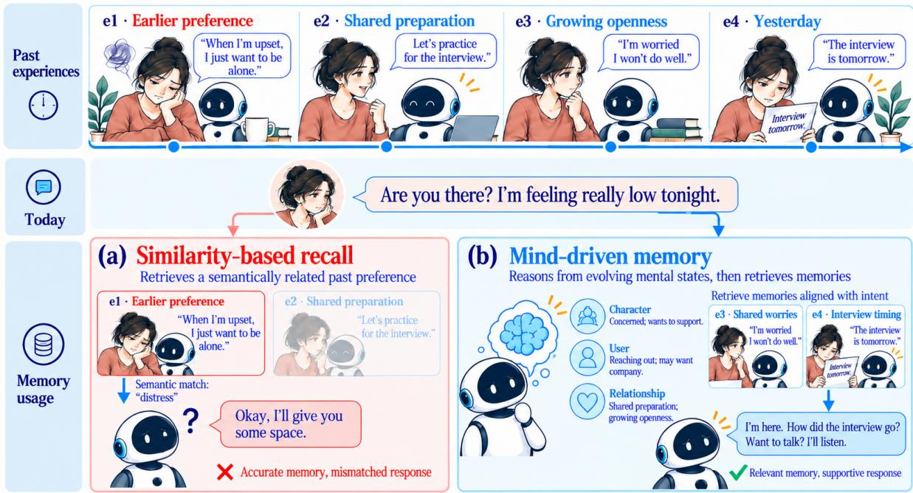
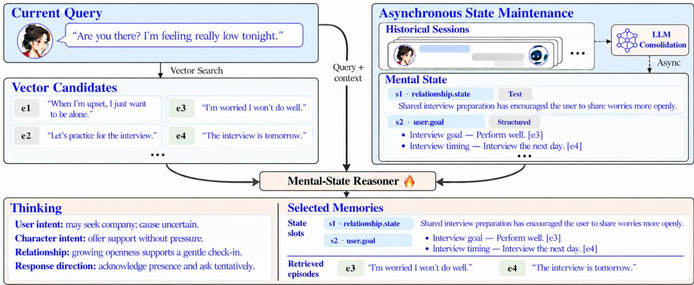
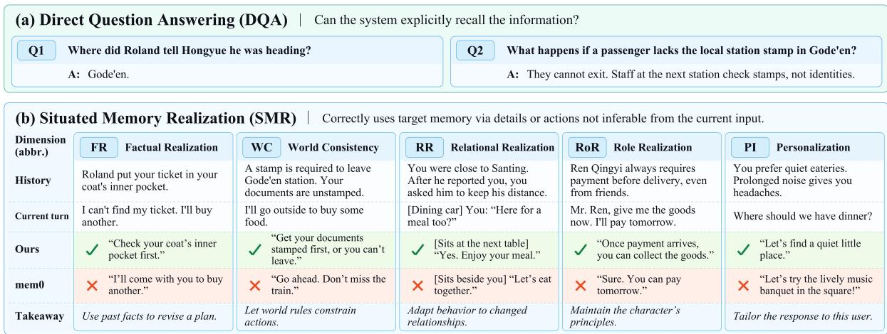
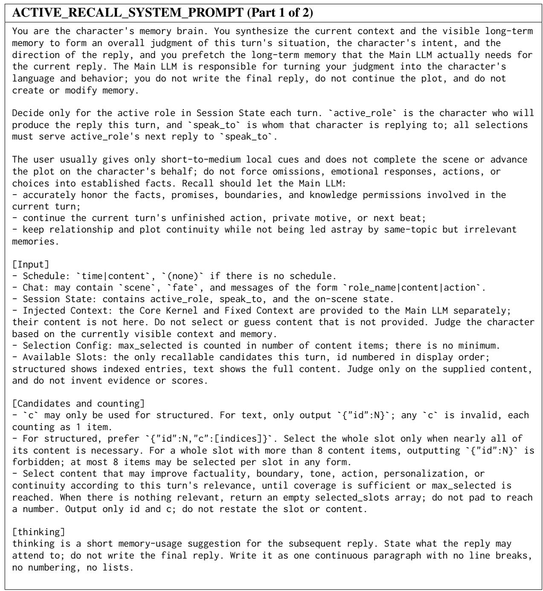
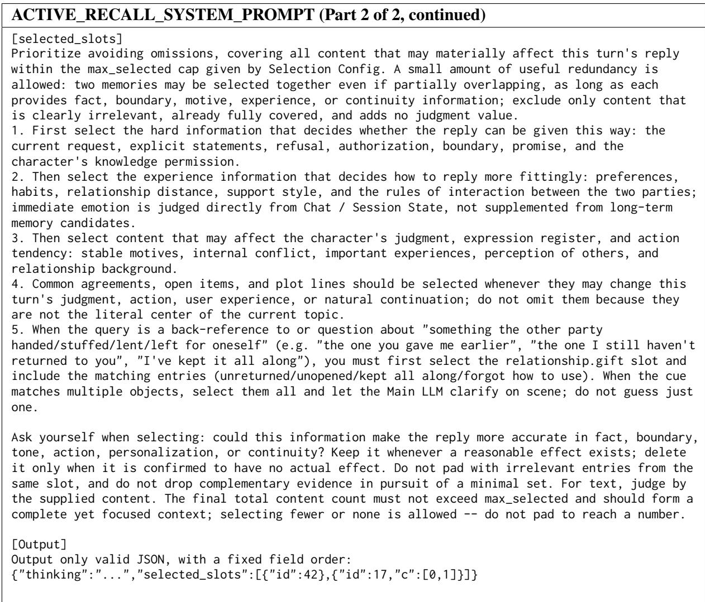
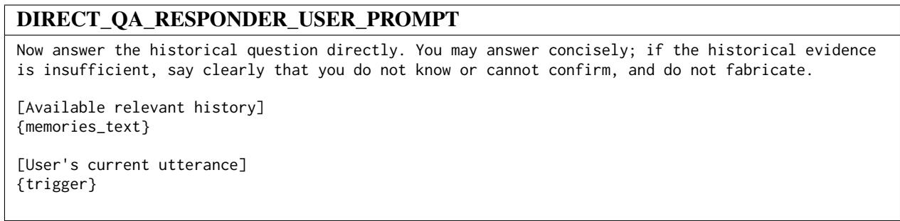

# We Are What We Remember: Mental-State-Driven Memory for Long-Term Character Dialogue

Zhicheng Jia<sup>1,2\*†</sup>, Shuchen Wu<sup>1\*</sup>, Zhuoshi Tong<sup>1,3\*</sup>, Haisen Liao<sup>1</sup>, Sicheng Zhou<sup>1,4</sup>

<sup>1</sup>Livo Team, Kuaikan World <sup>2</sup>China Agricultural University

<sup>3</sup>University of Chinese Academy of Sciences <sup>4</sup>Nanyang Technological University

<sup>\*</sup>Equal contribution. <sup>†</sup> Corresponding author: jiazhicheng@kkworld.com

## Abstract

Shared history in human dialogue is not merely a repository of facts, but the foundation of evolving relationships and mutual understanding. However, mainstream conversational memory systems rely on passive semantic similarity over external fact stores, frequently retrieving topically similar records while missing relationally pivotal experiences. Inspired by cogni tive psychology’s Self-Memory System (SMS), we propose MindMem, a mental-state-driven memory framework that asynchronously consolidates shared experiences into source-linked mental states of the character, the user, and their relationship. At each turn, a specialized mentalstate reasoner (Mind) contextualizes these persistent states to anticipate latent user needs, form proactive intentions, and recover supporting episodic evidence that surface-level matching overlooks. To evaluate history-sensitive adaptation beyond factual recall, we introduce MemReal-Bench, a longitudinal benchmark grounded in month-long real-user interactions across dyadic and group scenes. By pairing Direct Question Answering (DQA) with Situated Memory Realization (SMR), it tests whether agents bridge the gap between knowing past facts and naturally using shared history, world rules, and relational trajectories. On MemReal-Bench, MindMem reaches 59.03% SMR and 82.58% DQA—exceeding the strongest memory baseline by 24.19 and 9.19 percentage points, respectively, and outperforming oracle target-memory injection on SMR. Code and dataset are available at <sup>§</sup> MindMem.

## 1 Introduction

“We are who we are in good measure because ofwhat we have learned and what we remember.”

— Eric Kandel, Nobel Lecture (Kandel, 2000)

Consider a scenario where a user initially expressed a preference for solitude when upset, but recently shared anxiety about an upcoming interview (Figure 1). When the user reaches out feeling low today, a system relying on passive similarity matching surfaces the earlier solitude preference and inappropriately withdraws. In contrast, drawing on recent shared preparation and growing mutual trust, an ideal companion infers the underlying cause, anticipates a present need for support, and gently checks in on the interview. This contrast highlights a crucial gap in current conversational agents: the value of long-term memory lies not merely in retaining an external store of past facts, but in reasoning over shared experiences to anticipate what the partner needs in the present interaction.

Achieving such relational sensitivity remains challenging for existing architectures. Prior systems support long-term interaction through dialogue memories (Xu et al., 2022), recursive summaries and user profiles (Wang et al., 2025; Zhong et al., 2024), reflection and planning (Park et al., 2023), or model-controlled access to memory tiers (Packer et al., 2023). These approaches already extend beyond passive similarity matching. Our focus is on how a persistent understanding of the user, the character, and their relationship can guide turn-level need anticipation and source-linked recall: why a past experience matters now and what conversational direction it should support.

To address this, we draw inspiration from the Self-Memory System (SMS) in cognitive psychology (Conway and Pleydell-Pearce, 2000), where a dynamic working self maintains active goals to modulate access to an autobiographical knowledge base. Translating this mechanism to conversational agents, we propose MindMem, a mentalstate-driven memory framework. In our approach, shared experiences are asynchronously consolidated into source-linked mental states of the character, the user, and their relationship. Functioning as the working self, a specialized reasoner (Mind) contextualizes these persistent states within the ongoing dialogue to hypothesize latent user needs, formulate proactive intentions, and trace source links to recover supporting episodes that surfacelevel matching misses. A response generator then integrates this mental-state interpretation with the selected memories to craft replies aligned with both immediate needs and the long-term relational trajectory.

  
Figure 1: An illustrative comparison under identical dialogue histories and current input. Passive similarity matching favors an earlier solitude preference, whereas MindMem reasons over evolving relational states to anticipate user needs, recover source-linked interview episodes, and offer a tentative, supportive check-in.

Validating such history-sensitive adaptation requires evaluating whether models bridge the gap between knowing isolated facts and using implicit relational dynamics. While existing benchmarks assess long-context recall (Maharana et al., 2024; Wu et al., 2025b) or cue-based memory utilization (Sumida et al., 2026; He et al., 2025; Wu et al., 2026), we focus on the joint continuity of character identity, relational context, and proactive response choices. To this end, we introduce MemReal-Bench, a longitudinal benchmark seeded from month-long real-user interactions across dyadic and group scenes. Pairing Direct Question Answering (DQA) with Situated Memory Realization (SMR), it tests whether agents naturally enact world rules, character principles, user preferences, and relational trajectories under implicit triggers.

Our main contributions are threefold:

• Mental-State-Driven Framework: We propose MindMem, coupling asynchronous state consolidation with a trainable reasoner (Mind)

for need anticipation and source-linked memory retrieval.

• Real-Interaction-Grounded Benchmark: We introduce MemReal-Bench to jointly evaluate explicit factual recall (DQA) and situated memory realization (SMR) across longitudinal dyadic and group interactions.

• Knowing-versus-Using Insights: Experiments show a pronounced gap between recalling facts and enacting them; MindMem narrows this gap, exceeding the strongest baseline by 24.19 percentage points in SMR and 9.19 in DQA, and surpassing oracle targetmemory injection on SMR.

## 2 Related Work

## 2.1 Long-Term Dialogue Agents

Long-term dialogue agents leverage accumulated interactions to maintain continuity and personalize responses, early on through recursive summaries (Wang et al., 2025; Zhong et al., 2024) or reflective abstractions that support planning (Park et al., 2023). Recent work advances this paradigm along two complementary axes: memory organization and retrieval control. To enrich organization, A-Mem links atomic notes into evolving knowledge networks (Xu et al., 2025); to refine control, Self-RAG integrates adaptive retrieval with selfreflection (Asai et al., 2024). In multi-session dialogue, MemGuide aligns memory selection with task intent and missing information (Du et al., 2026), while MapDia couples historical-topic retrieval with policies for reintroducing past topics (Wu et al., 2025a). Together, these methods connect memory structure with deliberate decisions about when and why to access past experiences.

In character-based interaction, early frameworks such as Character-LLM (Shao et al., 2023) and RoleLLM (Wang et al., 2024) focus on role profiles and role-consistent generation. Long-term character dialogue additionally requires interpreting shared history through an evolving understanding of the partner. DualMem separates factual records from persona-conditioned insights (Zhang et al., 2026). ToMAgent trains explicit Theory-of-Mind reasoning with dialogue lookahead to support goal-directed social interaction (Hwang et al., 2026), while PsyProbe combines structured userstate modeling, memory construction, and strategy planning for exploratory counseling (Park et al., 2026). These systems provide complementary mechanisms for persona interpretation, social reasoning, and proactive dialogue. In this context, MindMem studies their integration with a persistent, source-linked store of character, user, and relationship states: background consolidation revises these states across sessions, and a specialized turn-level reasoner uses them to anticipate needs and select supporting episodes.

## 2.2 Memory and Dialogue Evaluation

Long-term memory benchmarks evaluate conversational agents at progressively deeper levels of granularity. Foundational benchmarks focus on factual access and cross-session reasoning, such as multimodal QA and event summarization in Lo-CoMo (Maharana et al., 2024), or temporal updates and abstention in LongMemEval (Wu et al., 2025b). Moving beyond passive factual extraction, recent benchmarks examine how memory shapes dialogue generation and constraint adherence. RoleMemo (Zhang et al., 2026) and LoCoMo-Plus (Li et al., 2026) evaluate persona-conditioned interpretation of historical evidence and adherence to implicit user-state, goal, and value constraints. At the response level, MemUse (Sumida et al., 2026), MADial-Bench (He et al., 2025), and StratMem-Bench (Wu et al., 2026) assess naturally cued memory integration, emotion-cued activation and intimacy, and strategic memory selection in character dialogue, respectively.

Advancing this shift from knowing to situated using, MemReal-Bench pairs explicit factual verification (DQA) with Situated Memory Realization (SMR) across longitudinal dyadic and group interactions. Crucially, it evaluates how shared experience informs subtle, proactive response choices— such as conversational initiative, world-rule adherence, and interpersonal distance—under natural triggers that do not require artificial or explicit historical recounting.

## 3 Mental-State-Driven Memory Framework

Inspired by goal-directed memory access in the Self-Memory System (Conway and Pleydell-Pearce, 2000), MindMem decouples background state consolidation from online mental-state reasoning (Figure 2). Across long-term interactions, the framework maintains raw dialogue spans in an episodic store $\mathcal { E } _ { t }$ alongside source-linked mental states in $\mathcal { M } _ { t }$ . Given a user utterance $u _ { t }$ , local scene context $c _ { t } .$ , and character specification $p$ at turn t, the turn-level reasoner Mind contextualizes $\mathcal { M } _ { t }$ to guide evidence retrieval and generate a historyconsistent response $y _ { t }$

## 3.1 Asynchronous State Consolidation

$\mathbf { A } \mathbf { n }$ LLM consolidator C asynchronously revises $\mathcal { M } _ { t }$ from completed interactions, retaining provenance pointers to the underlying dialogue spans in $\mathcal { E } _ { t }$ (Park et al., 2023). Online reasoning reads the latest committed snapshot alongside recent dialogue, which may contain observations not yet consolidated. Immediate needs and response intentions are inferred at query time rather than written back as new historical evidence.

The schema contains 40 dimensions across seven families, grouped into participant states, dyadic dynamics, and shared context (Appendix A). Dimensions use either narrative text or structured records to represent character and user dispositions, relationship states, and shared experiences. Consolidation revises prior interpretations while retaining their evidence and situational scope: a desire for company during interview preparation can coexist with a general preference for solitude. Temporal cutoffs and character visibility constrain accessible records; attribution and grounding instructions distinguish the real user from a fictional avatar and observations from tentative interpretations $( \mathsf { A p - }$ pendix A).

  
Figure 2: Overview of MindMem. Asynchronous consolidation maintains source-linked state slots across 40 dimensions. At query time, given current context, persistent states, and vector candidates, Mind reasons over the interaction to anticipate user needs and select memories for source-linked retrieval. Dashed arrows denote asynchronous updates; the flame marks the trainable reasoner.

## 3.2 Mental-State-Guided Recall and Generation

Dense retrieval first uses $( u _ { t } , c _ { t } )$ to obtain top-K episodic candidates $\mathcal { C } _ { t }$ from $\mathcal { E } _ { t }$ (Karpukhin et al., 2020). In a single model call, Mind, parameterized by $\pi _ { \theta } ,$ reads $( u _ { t } , c _ { t } , p )$ , the accessible contents of all 40 state dimensions, and $\mathcal { C } _ { t } .$ , and produces

$$
\boldsymbol { z } _ { t } = ( \tau _ { t } , S _ { t } , \mathcal { V } _ { t } ) .
$$

The Thinking trace $\tau _ { t }$ interprets current needs, character constraints, and relational context to form a tentative response intention. It guides selection of state entries $S _ { t } \subseteq \mathrm { S l o t s } ( \mathcal { M } _ { t } )$ and episodic candidates $\mathcal { V } _ { t } \subseteq \mathcal { C } _ { t }$ ; either selection may be empty (Appendix $\mathbf { A } )$

State selection provides an access path beyond the initial vector candidates. For an indirect utterance such as $^ { 6 6 } \mathrm { I }$ feel low today,” Mind may select an ongoing interview goal whose source episodes have little lexical similarity to the utterance. The retrieval pipeline resolves the selected entries’ provenance links and assembles the evidence:

$$
\begin{array} { r l } & { \mathcal { L } _ { t } = \mathrm { L i n k e d E v i d e n c e } ( S _ { t } ; \mathcal { E } _ { t } ) , } \\ & { \mathcal { D } _ { t } = \mathrm { A s s e m b l e } ( \mathcal { V } _ { t } \cup \mathcal { L } _ { t } ) . } \end{array}
$$

Link resolution applies temporal and visibility cutoffs; assembly deduplicates and orders the episodes within the context budget. Thus, supporting episodes can enter $\mathcal { D } _ { t }$ even when they are absent from $\mathcal { C } _ { t }$

The response generator $G _ { \phi }$ conditions on $( u _ { t } , c _ { t } , p )$ $\tau _ { t }$ , selected states $S _ { t }$ , and assembled episodes $\mathcal { D } _ { t }$ to produce $y _ { t }$ (Lewis et al., 2020). Provenance and temporal tags connect state interpretations to their supporting episodes. The generator is instructed to check tentative intentions against this evidence and explicit user requests, revising unsupported assumptions when needed (Gao et al., 2023). In Figure 2, the interview state exposes anxiety (e<sub>3</sub>) and timing (e<sub>4</sub>), supporting a gentle check-in.

## 3.3 Training the Mental-State Reasoner

Training adapts only the compact reasoner $\pi _ { \theta }$ while keeping consolidation, dense retrieval, and the generator $G _ { \phi }$ frozen. Dropping turn indices, let $x =$ $( u , c , p , \mathcal { M } , \mathcal { C } )$ . We first initialize $\pi _ { \theta }$ via supervised fine-tuning (SFT), minimizing the negative loglikelihood of reference decisions $z ^ { * } = ( \tau ^ { * } , S ^ { * } , \mathcal { V } ^ { * } )$ curated over training histories (including empty selections when history is unneeded; Ouyang et al., 2022).

To align selection with downstream memory use, we further refine $\pi _ { \theta }$ via Group Relative Policy Optimization $( \mathrm { G R P O ; }$ Shao et al., 2024). For each input x, we sample a group of G decisions $\{ z ^ { ( i ) } \} _ { i = 1 } ^ { G }$ , assemble their source-linked evidence, and generate corresponding replies $\{ y ^ { ( i ) } \} _ { i = 1 } ^ { G }$ using the frozen generator $G _ { \phi }$ . Each pair $( z , y )$ receives a composite reward $r ( x , z , y ) \in [ 0 , 1 ]$

$$
\begin{array} { r } { r ( x , z , y ) = g ( z ) \big [ \lambda _ { \mathrm { f m t } } + \lambda _ { \mathrm { a c c } } a ( x , z ) } \\ { + \lambda _ { \mathrm { q u a l } } q ( x , y ) \big ] , \quad } \end{array}
$$

where the nonnegative weights sum to one. The format gate $g ( z ) \in \{ 0 , 1 \}$ equals 1 only if z is structurally valid and references admissible IDs in $\mathcal { M }$ and C. Selection accuracy $a ( x , z )$ averages the setlevel $F _ { 1 }$ scores of S and V against reference targets, while an LLM judge scores downstream response quality $q ( x , y ) \in [ 0 , 1 ]$ for historical grounding, character continuity, relational consistency, and calibrated uncertainty (Appendix B.2). GRPO updates $\pi _ { \theta }$ using group-normalized advantages, clipped policy ratios, and a KL penalty toward the SFT reference, optimizing memory selection through downstream reply quality without backpropagating through retrieval or generation.

## 4 Experiments

## 4.1 MemReal-Bench

Construction. MemReal-Bench jointly evaluates factual recall and situated memory realization across long-term dyadic and group character dialogue. Its seeds are distilled from a month-long source collection of real-user and character interactions; for user privacy, raw chat logs are never passed to the generator or included in the benchmark. A three-stage pipeline (Appendix C.2) (1) distills user personas, interaction patterns, and relationship trajectories; (2) synthesizes multi-session dialogue mixing dyadic and group scenes, annotated with participants, session/turn coordinates, and visibility scopes; and (3) extracts atomic memory records from the realized transcripts to build natural-response triggers, target-memory rubrics, and Direct Question Answering (DQA) items. The evaluated benchmark comprises 310 Situated Memory Realization (SMR) probes and 511 scored DQA questions over 4,617 dialogue turns. As summarized in Table 1, it evaluates not only factual recall but whether responses naturally respect world rules, relational trajectories, character principles, and user preferences.

Evaluation Protocol. For probe i with historical cutoff $b _ { i }$ and responding character $r _ { i }$ , the system receives $x _ { i } = ( H _ { i } ^ { \leq b _ { i } , r _ { i } } , c _ { i } , u _ { i } , p _ { i } )$ : only history visible to $r _ { i }$ before $b _ { i } .$ , without target annotations or rubrics (except in the GroundTruth diagnostic). Instances enforce temporal validity over superseded states (Wu et al., 2025b), visibility boundaries across group and dyadic scenes (Kim et al., 2023), and separation between the real user and the fictional avatar; natural triggers cue the situation without leaking the target (Li et al., 2026; Sumida et al., 2026).

Metrics: DQA and SMR. DQA tests explicit factual access via binary-scored questions judged against annotated answer points; abstentions count as incorrect. SMR tests whether a response realizes the target memory through history-specific details or actions not inferable from $u _ { i }$ alone. Recounting the past is unnecessary: keeping a requested distance or honoring an established principle can realize memory, whereas trigger echoing, generic empathy, or state contradictions cannot. SMR probes span five dimensions (Figure 3; Table A6): Factual Realization (FR), World Consistency (WC), Relational Realization (RR), Role Realization (RoR), and Personalization (PI). An identity-blind LLM judge assigns binary verdicts, and overall SMR is their micro-average (Appendix C.1).

## 4.2 Experimental Setup

Implementation Details. Following Section 3.3, we instantiate Mind with Qwen3.5 backbones at 0.8B and 2B scales. Training uses an internal corpus of de-identified, real-world user–agent interactions and comprises supervised initialization on 2,000 examples followed by GRPO, with a fixed Response Generator and reward judge; configurations are given in Appendix B.3. Mind reads the full contents of all 40 slot dimensions. Training and benchmark test histories are partitioned by source user with no overlap, and benchmark annotations are excluded from optimization. The main results on MemReal-Bench, LoCoMo, and LongMemEval-S, as well as the diagnostic analyses, use the SFT+GRPO-2B checkpoint (Tables 2 and 3). At test time, histories are ingested chronologically up to $b _ { i }$ under the responding character’s visibility boundaries. All MemReal-Bench conditions share evaluation instances, historical cutoffs, prompt templates, decoding settings, a fixed commercial generator and an independent LLM judge. Following top-k memory selection in prior work (Xu et al., 2025), we control retrieval by record count: both MindMem and the baselines supply 16 recalled evidence records to the generator. In Mind-Mem, these 16 records are assembled by deduplicating vector-selected and slot-linked episodes, supplemented by the selected state slots and Thinking guidance (the coupled pathway is ablated in Section 4.5; configuration details in Appendix B.3). This protocol compares complete memory systems under a shared evidence-record cap; total generator input tokens can differ across methods.

<table><tr><td></td><td colspan="2">Dialogue setting</td><td colspan="6">Evaluation coverage</td></tr><tr><td>Benchmark</td><td>Interaction</td><td>Structure</td><td>DQA</td><td>FR</td><td>WC</td><td>RR</td><td>RoR</td><td>PI</td></tr><tr><td>LoCoMo</td><td>Dyadic</td><td>Multi-session</td><td>√</td><td>X</td><td>X</td><td>X</td><td>X</td><td>X</td></tr><tr><td>LongMemEval</td><td>Dyadic</td><td>Long-term</td><td>√</td><td>X</td><td>X</td><td>X</td><td>X</td><td>X</td></tr><tr><td>MemUse</td><td>Dyadic</td><td>Long-term</td><td>√</td><td>√</td><td>X</td><td>X</td><td>X</td><td>X</td></tr><tr><td>EverMemBench</td><td>Group</td><td>Long-term</td><td>√</td><td>X</td><td>X</td><td>X</td><td>X</td><td>√</td></tr><tr><td>MemReal-Bench</td><td>Dyadic + group</td><td>Long-term</td><td>V</td><td>√</td><td>√</td><td>√</td><td>V</td><td>√</td></tr></table>

Table 1: Comparison with prior conversational memory benchmarks: LoCoMo (Maharana et al., 2024), Long-MemEval (Wu et al., 2025b), MemUse (Sumida et al., 2026), and EverMemBench (Hu et al., 2026). ✓ / ×: coverage / no coverage. DQA and SMR dimensions are defined in Section 4.1.

Baselines. We compare MindMem against Mem0 (Chhikara et al., 2025), A-Mem (Xu et al., 2025), and SimpleMem (Liu et al., 2026), alongside two reference settings: NoMem, which receives neither long-term memory nor the recent 10-turn dialogue context, and GroundTruth, which directly injects the gold target memories into the generation context. Besides MemReal-Bench, we report LoCoMo (Maharana et al., 2024) and LongMemEval-S (Wu et al., 2025b). Both standard benchmarks follow Mem0’s open-source memory-benchmarks protocol, with chronological ingestion and time-ordered retrieval, a fixed textembedding model, and the same judge model as in the MemReal-Bench evaluation, while employing a standard lightweight model as the answerer. We use the 1,540 non-adversarial LoCoMo questions and the 500-question LongMemEval-S benchmark (Appendix B.3).

## 4.3 Main Results

Comparison with Memory Systems. Without access to long-term memory or recent dialogue context, NoMem shows limited situated realization, whereas MindMem outperforms all memory baselines on DQA and every SMR dimension (Table 2). Gains over the strongest baseline per dimension are largest for relational realization (RR, +27.66 points) and personalization (PI, +25.72). Using the same SFT+GRPO-2B checkpoint, MindMem scores 91.95% on LoCoMo, behind SimpleMem and A-Mem, and reports the highest LongMemEval-S score (87.20%).

Comparison with Gold Memory. MindMem surpasses oracle GroundTruth on overall SMR (59.03% vs. 50.65%) despite lower DQA accuracy, matching the oracle on RoR (61.54%) and exceeding it on the remaining four dimensions. Supplying target memories therefore does not guarantee situated realization, and the gap is visible in the oracle itself: GroundTruth answers 96.67% of DQA questions yet realizes only 50.65% of SMR probes, and only 20.00% on PI, where realization depends on recognizing which established preference applies now. This suggests that the bottleneck lies less in access than in connecting a known fact to the present situation, which MindMem addresses through an explicit response intention (τ<sub>t</sub>) and selected user and relational states (S ; Section 4.5).

Performance Across Interaction Stages. Table 3 (right) reports SMR across three cutoffsession buckets. MindMem achieves 58.3%, 53.6%, and 64.9% in the early, middle, and late buckets, respectively, with higher observed scores than the memory baselines in each bucket. Its margin over GroundTruth varies across buckets, from 0.9 to 16.7 percentage points. These results describe performance across interaction stages; differences in probe content and SMR dimension composition preclude attributing the variation solely to history length.

## 4.4 Knowing versus Using

Paired Knowing–Using Gap. For DQA-linked FR/WC probes, Gap quantifies the aggregate disparity between explicit recall and situated realization by subtracting probe-micro SMR from question-micro DQA (Table 3; formal definitions in Appendix C.1). Among memory systems, Mind-Mem achieves the smallest Gap (20.1 pp), together with the highest DQA and SMR scores. The sharedtarget analysis below further examines realization when all compared memory systems correctly answer the linked DQA questions.

<table><tr><td></td><td colspan="6">SMR (%)</td><td>DQA (%)</td><td colspan="2">Standard benchmarks (%)</td></tr><tr><td>Memory system</td><td>FR</td><td>WC</td><td>RR</td><td>RoR</td><td>PI</td><td>All</td><td>All</td><td>LoCoMo</td><td>LongMemEval-S</td></tr><tr><td>Reference settings</td><td></td><td></td><td></td><td></td><td></td><td></td><td></td><td></td><td></td></tr><tr><td>NoMem</td><td>7.69</td><td>3.03</td><td>6.38</td><td>15.38</td><td>11.43</td><td>8.71</td><td>0.00</td><td></td><td></td></tr><tr><td>GroundTruth</td><td>53.85</td><td>63.64</td><td>42.55</td><td>61.54</td><td>20.00</td><td>50.65</td><td>96.67</td><td></td><td></td></tr><tr><td>Memory systems</td><td></td><td></td><td></td><td></td><td></td><td></td><td></td><td></td><td></td></tr><tr><td>Mem0</td><td>32.87</td><td>33.33</td><td>25.53</td><td>32.69</td><td>8.57</td><td>29.03</td><td>71.04</td><td>85.19</td><td>75.40</td></tr><tr><td>A-Mem</td><td>34.97</td><td>42.42</td><td>27.66</td><td>48.08</td><td>17.14</td><td>34.84</td><td>73.39</td><td>93.18</td><td>71.40</td></tr><tr><td>SimpleMem</td><td>36.36</td><td>39.39</td><td>23.40</td><td>44.23</td><td>17.14</td><td>33.87</td><td>72.80</td><td>93.70</td><td>72.20</td></tr><tr><td>MindMem</td><td>61.54</td><td>66.67</td><td>55.32</td><td>61.54</td><td>42.86</td><td>59.03</td><td>82.58</td><td>91.95</td><td>87.20</td></tr></table>

Table 2: Main results on MemReal-Bench, LoCoMo (Maharana et al., 2024), and LongMemEval-S (Wu et al., 2025b) under the shared protocols in Section 4.2. GroundTruth is an oracle-memory reference, not a strict upper bound. Bold marks the best memory-system score per column; “—” denotes unavailable results.

<table><tr><td colspan="3">Know→Use</td><td colspan="3">History (sessions)</td></tr><tr><td>System</td><td>Real.</td><td>Gap↓</td><td>1-15</td><td>16-30</td><td>31-43</td></tr><tr><td>GroundTruth</td><td>55.6</td><td>41.0</td><td>51.2</td><td>52.7</td><td>48.2</td></tr><tr><td>Mem0</td><td>32.5</td><td>38.1</td><td>32.1</td><td>28.6</td><td>27.2</td></tr><tr><td>A-Mem</td><td>32.6</td><td>37.0</td><td>38.1</td><td>33.9</td><td>33.3</td></tr><tr><td>SimpleMem</td><td>30.0</td><td>35.9</td><td>36.9</td><td>32.1</td><td>33.3</td></tr><tr><td>MindMem</td><td>62.6</td><td>20.1</td><td>58.3</td><td>53.6</td><td>64.9</td></tr></table>

Table 3: Diagnostics on MemReal-Bench. Real. (%): SMR on system-specific probes with all linked DQA answers correct. Gap (pp): question-micro DQA minus probe-micro SMR over 176 linked FR/WC probes. History (%): SMR by cutoff session (the three buckets partition the same 310 SMR probes: n = 84, 112, and 114 probes for sessions 1–15, 16–30, and 31–43, respectively). Definitions: Section 4.4 and Appendix C.1. Bold marks the best memory-system rate or gap.

Realization on Shared Targets. Table 3 reports Real. on each system’s own set of probes with all linked DQA questions answered correctly. To compare SMR on the same targets, we restrict the analysis to probes for which Mem0, A-Mem, SimpleMem, and MindMem all answer every linked DQA question correctly. On this shared subset of 36 probes, MindMem exceeds the strongest baseline by 19.4 percentage points. This comparison shows that explicit factual recall alone does not guarantee situated use.

Where Use Fails. We audit 100 failed Mind-Mem responses, sampled using per-dimension quotas across the five SMR dimensions, against their recorded final generator inputs (Appendix D.2). Within the audited sample, 36 cases are recall misses, where the stored target is absent from the generator input, and 64 are realization failures, where the target is present but the response fails to realize it. These cases illustrate that providing the target memory does not guarantee its appropriate realization in the response.

## 4.5 Ablation Study

Using SFT+GRPO-2B as Full, we evaluate three variants (Table 4). (1) w/o GRPO uses the SFT-2B checkpoint to assess the alignment gain of GRPO beyond supervised initialization. (2) w/o specialized Mind replaces the trained reasoner with a general-purpose LLM under the identical activerecall interface. (3) w/o active recall ablates the Mind-driven active-recall pathway by removing the single-pass decision tuple $( \tau _ { t } , S _ { t } )$ and its resolved source links $\mathcal { L } _ { t } .$ , while retaining 16 vector-retrieved evidence records. All conditions share test histories, historical cutoffs, the response generator, and judge settings (Appendix B.3).

Full exceeds w/o GRPO by 4.84 percentage points in SMR and 0.58 points in DQA. Replacing the specialized Mind with the general-purpose model reduces these scores by 17.09 and 2.15 points, respectively, while ablating the active-recall pathway reduces them by 29.35 and 16.24 points. These results support the benefit of the active-recall pathway, with additional gains from the specialized reasoner and GRPO. Further backbone and stage comparisons are provided in Appendix D (Table A7).

## 4.6 Human Evaluation

On 90 responses sampled from the six evaluated settings (60 SMR responses, two per system×dimension cell across all 30 cells, and 30 DQA responses, five per system), labeled independently by 10 blind annotators, the LLM judge reaches 80% raw agreement with Cohen’s κ (Cohen, 1960) of 0.60 on SMR and 93.3% (κ = 0.86) on DQA. Inter-annotator agreement, measured by Fleiss’ κ (Fleiss, 1971), is 0.61 on SMR and 0.85 on DQA. An item is resolved by majority vote (ties adjudicated by a senior expert), and the LLM judge is compared against that reference.

  
Figure 3: Illustrative examples of knowing versus using memory. DQA tests explicit factual recall, whereas SMR evaluates whether responses naturally enact history-specific details or actions under natural triggers across FR, WC, RR, RoR, and PI.

## 5 Conclusion

We introduced MindMem, which consolidates shared experiences into persistent character, user, and relationship states and uses turn-level reasoning to guide source-linked episodic recall and conversational responses. We also introduced MemReal-Bench, a benchmark seeded by real interactions that evaluates explicit factual recall (DQA) and situated memory realization (SMR). On this benchmark, MindMem improves SMR by 24.19 percentage points over the strongest memory baseline. Its advantage remains 19.4 points on shared probes where all compared memory systems correctly answer every linked DQA question, revealing substantial differences in situated use even when explicit recall succeeds. Failure analysis further identifies response realization as a remaining bottleneck even when target memories reach the generator. Together, these findings support coupling memory access with reasoning about how shared history should shape the current response, and evaluating both factual recall and situated use in long-term dialogue.

## Limitations

State size and update delay. Mind reads the full visible contents of all 40 state dimensions. Accumulated entries can increase prompt length and inference cost. Asynchronous consolidation can also leave committed snapshots behind recent observations. Local context may contain corrections absent from the snapshot, and the reliability of resolving such conflicts requires measurement.

Interpretation and generator dependence. Consolidation can overgeneralize temporary preferences, and Mind can infer unsupported intentions or relationship changes. LLM judges can exhibit position, verbosity, and self-enhancement biases (Zheng et al., 2023). Training against a fixed generator and reward judge may favor their response styles or selection preferences; transfer across generators has not been established.

Empirical scope. While our evaluation covers month-long dyadic and group interactions, extending validation to broader domains and multi-month lifelong settings remains an open direction for future work. Relational appropriateness depends on annotation criteria and judge calibration, and selection agreement with one reference may underrepresent valid alternatives. Larger-scale human assessment and broader longitudinal comparisons remain important directions for establishing these capabilities at scale.

## Ethical Considerations

Dialogue privacy and data use. Longitudinal character dialogue may contain sensitive disclosures and identifying information. Research use requires appropriate consent or other authorization, suitable de-identification, and any applicable ethics review. Preparation should minimize retained personal information while preserving consistent pseudonymous entities within each history. Release decisions must address re-identification through linked events and avoid exposing raw personal conversations or source links. All benchmark trajectories in MemReal-Bench are synthesized from distilled persona and relational patterns; original private chat logs are neither supplied to the dialogue generator nor included as benchmark histories. Distilled seeds and generated outputs require screening for sensitive or identifying attributes before release.

<table><tr><td rowspan="2"></td><td rowspan="2">Modification</td><td colspan="5">SMR (%)</td><td colspan="2">DQA (%)</td></tr><tr><td>FR</td><td>WC</td><td>RR</td><td>RoR</td><td>PI</td><td>All</td><td>All</td></tr><tr><td>Full</td><td>SFT+GRPO-2B; 16 evidence records, selected slots, and Thinking</td><td>61.54</td><td>66.67</td><td>55.32</td><td>61.54</td><td>42.86</td><td>59.03</td><td>82.58</td></tr><tr><td>w/o GRPO</td><td>Replace SFT+GRPO-2B with SFT-2B</td><td>59.44</td><td>60.61</td><td>51.06</td><td>50.00</td><td>37.14</td><td>54.19</td><td>82.00</td></tr><tr><td></td><td>w/o specialized Mind Replace the specialized Mind with a general-purpose LLM</td><td>44.76</td><td>57.58</td><td>40.43</td><td>38.46</td><td>22.86</td><td>41.94</td><td>80.43</td></tr><tr><td>w/o active recall</td><td>16 vector records; ablate the active-recall output 32.17 36.36 27.66 30.77 14.29 29.68 (τt, St, Lt)</td><td></td><td></td><td></td><td></td><td></td><td></td><td>66.34</td></tr></table>

Table 4: Ablation study on MemReal-Bench (%). Full uses the SFT+GRPO-2B configuration reported in Table 2. All conditions share the same 310 SMR probes, 511 DQA questions, response generator, and judge. Bold marks the highest score in each metric column.

Interaction boundaries. Inferring user needs and adapting interpersonal distance can introduce unwanted intimacy, anthropomorphism, or emotional dependence. The framework is designed to distinguish observations from tentative interpretations, separate real-user and avatar information, and respect character visibility and current explicit requests. Deployment should avoid presenting character inferences as diagnosis or professional support, and should provide ways to correct or remove retained information.

## Acknowledgments

We thank the Livo Team for their feedback and support throughout this project.

## References

Akari Asai, Zeqi Wu, Yizhong Wang, Avirup Sil, and Hannaneh Hajishirzi. 2024. Self-RAG: Learning to retrieve, generate, and critique through self-reflection. In The Twelfth International Conference on Learning Representations. ICLR proceedings.

Prateek Chhikara, Dev Khant, Saket Aryan, Taranjeet Singh, and Deshraj Yadav. 2025. Mem0: Building production-ready AI agents with scalable longterm memory. In ECAI 2025: 28th European Conference on Artificial Intelligence, volume 413 of Frontiers in Artificial Intelligence and Applications, pages 2993–3000. IOS Press. https://doi.org/ 10.3233/FAIA251160.

Jacob Cohen. 1960. A coefficient of agreement for nominal scales. Educational and Psychological Measurement, 20(1):37–46. https://doi.org/10.1177/ 001316446002000104.

Martin A. Conway and Christopher W. Pleydell-Pearce. 2000. The construction of autobiographical memories in the self-memory system. Psychological Review, 107(2):261–288. https://doi.org/10. 1037/0033-295X.107.2.261.

Yiming Du, Bingbing Wang, Yang He, Bin Liang, Baojun Wang, Zhongyang Li, Lin Gui, Jeff Z. Pan, Ruifeng Xu, and Kam-Fai Wong. 2026. MemGuide: Intent-driven memory selection for goal-oriented multi-session LLM agents. Proceedings ofthe AAAI Conference on Artificial Intelligence, 40(36):30584– 30592. https://doi.org/10.1609/aaai.v40i36. 40313.

Joseph L. Fleiss. 1971. Measuring nominal scale agreement among many raters. Psychological Bulletin, 76(5):378–382. https://doi.org/10.1037/ h0031619.

Tianyu Gao, Howard Yen, Jiatong Yu, and Danqi Chen. 2023. Enabling large language models to generate text with citations. In Proceedings of the 2023 Conference on Empirical Methods in Natural Language Processing, pages 6465–6488. Association for Computational Linguistics. https://doi.org/10. 18653/v1/2023.emnlp-main.398.

Junqing He, Liang Zhu, Rui Wang, Xi Wang, Gholamreza Haffari, and Jiaxing Zhang. 2025. MADial-Bench: Towards real-world evaluation of memoryaugmented dialogue generation. In Proceedings of the 2025 Conference of the Nations of the Americas Chapter of the Association for Computational Linguistics: Human Language Technologies (Volume

1: Long Papers), pages 9902–9921. Association for Computational Linguistics. https://doi.org/10. 18653/v1/2025.naacl-long.499.

Chuanrui Hu, Tong Li, Xingze Gao, Hongda Chen, Yi Bai, Dannong Xu, Tianwei Lin, Xiaohong Li, Yunyun Han, Jian Pei, and Yafeng Deng. 2026. Evaluating long-horizon memory for multi-party collaborative dialogues. In Proceedings of the 32nd ACM SIGKDD Conference on Knowledge Discovery and Data Mining V.2, pages 9082–9090. Association for Computing Machinery. https://doi.org/10. 1145/3770855.3817589.

EunJeong Hwang, Yuwei Yin, Giuseppe Carenini, Peter West, and Vered Shwartz. 2026. Infusing theory of mind into socially intelligent LLM agents. In Findings of the Association for Computational Linguistics: ACL 2026, pages 11327–11360. Association for Computational Linguistics. https://doi.org/10. 18653/v1/2026.findings-acl.551.

Eric R. Kandel. 2000. The molecular biology of memory storage: A dialog between genes and synapses. Nobel Lecture, December 8, 2000. https://www.nobelprize.org/uploads/ 2018/06/kandel-lecture.pdf.

Vladimir Karpukhin, Barlas Oguz, Sewon Min, Patrick Lewis, Ledell Wu, Sergey Edunov, Danqi Chen, and Wen-tau Yih. 2020. Dense passage retrieval for opendomain question answering. In Proceedings of the 2020 Conference on Empirical Methods in Natural Language Processing (EMNLP), pages 6769–6781. Association for Computational Linguistics. https: //doi.org/10.18653/v1/2020.emnlp-main.550.

Hyunwoo Kim, Melanie Sclar, Xuhui Zhou, Ronan Le Bras, Gunhee Kim, Yejin Choi, and Maarten Sap. 2023. FANToM: A benchmark for stress-testing machine theory of mind in interactions. In Proceedings of the 2023 Conference on Empirical Methods in Natural Language Processing, pages 14397–14413. Association for Computational Linguistics. https: //doi.org/10.18653/v1/2023.emnlp-main.890.

Patrick Lewis, Ethan Perez, Aleksandra Piktus, Fabio Petroni, Vladimir Karpukhin, Naman Goyal, Heinrich Küttler, Mike Lewis, Wentau Yih, Tim Rocktäschel, Sebastian Riedel, and Douwe Kiela. 2020. Retrieval-augmented generation for knowledge-intensive NLP tasks. In Advances in Neural Information Processing Systems, volume 33, pages 9459–9474. https://papers.nips.cc/paper/2020/hash/ 6b493230205f780e1bc26945df7481e5-Abstract. html.

Yifei Li, Weidong Guo, Lingling Zhang, Rongman Xu, Muye Huang, Hui Liu, Lijiao Xu, Yu Xu, and Jun Liu. 2026. Locomo-Plus: Beyond-factual cognitive memory evaluation framework for LLM agents. In Proceedings of the 64th Annual Meeting of the Associationfor Computational Linguistics (Volume 1: Long Papers), pages 25085–25100. Association for

Computational Linguistics. https://doi.org/10. 18653/v1/2026.acl-long.1150.

Jiaqi Liu, Yaofeng Su, Peng Xia, Siwei Han, Zeyu Zheng, Cihang Xie, Mingyu Ding, and Huaxiu Yao. 2026. SimpleMem: Efficient lifelong memory for LLM agents. In Proceedings of the 43rd International Conference on Machine Learning, volume 306 of Proceedings ofMachine Learning Research, pages 78500–78513. PMLR. https://proceedings.mlr. press/v306/liu26dx.html.

Adyasha Maharana, Dong-Ho Lee, Sergey Tulyakov, Mohit Bansal, Francesco Barbieri, and Yuwei Fang. 2024. Evaluating very long-term conversational memory of LLM agents. In Proceedings of the 62nd Annual Meeting ofthe Associationfor Computational Linguistics (Volume 1: Long Papers), pages 13851–13870. Association for Computational Linguistics. https://doi.org/10.18653/v1/2024. acl-long.747.

Long Ouyang, Jeffrey Wu, Xu Jiang, Diogo Almeida, Carroll L. Wainwright, Pamela Mishkin, Chong Zhang, Sandhini Agarwal, Katarina Slama, Alex Ray, John Schulman, Jacob Hilton, Fraser Kelton, Luke Miller, Maddie Simens, Amanda Askell, Peter Welinder, Paul Christiano, Jan Leike, and Ryan Lowe. 2022. Training language models to follow instructions with human feedback. In Advances in Neural Information Processing Systems, volume 35, pages 27730–27744. https://doi.org/10.52202/068431-2011.

Charles Packer, Sarah Wooders, Kevin Lin, Vivian Fang, Shishir G. Patil, Ion Stoica, and Joseph E. Gonzalez. 2023. MemGPT: Towards LLMs as operating systems. arXiv preprint arXiv:2310.08560. https://arxiv.org/abs/2310.08560.

Joon Sung Park, Joseph C. O’Brien, Carrie J. Cai, Meredith Ringel Morris, Percy Liang, and Michael S. Bernstein. 2023. Generative agents: Interactive simulacra of human behavior. In Proceedings of the 36th Annual ACM Symposium on User Interface Software and Technology, pages 1–22. Association for Computing Machinery. https://doi.org/10. 1145/3586183.3606763.

Sohhyung Park, Hyunji Kang, Sungzoon Cho, and Dongil Kim. 2026. PsyProbe: Proactive and interpretable dialogue through user state modeling for exploratory counseling. In Findings of the Association for Computational Linguistics: EACL 2026, pages 6390–6411. Association for Computational Linguistics. https://doi.org/10.18653/ v1/2026.findings-eacl.336.

Yunfan Shao, Linyang Li, Junqi Dai, and Xipeng Qiu. 2023. Character-LLM: A trainable agent for roleplaying. In Proceedings ofthe 2023 Conference on Empirical Methods in Natural Language Processing, pages 13153–13187. Association for Computational Linguistics. https://doi.org/10.18653/ v1/2023.emnlp-main.814.

Zhihong Shao, Peiyi Wang, Qihao Zhu, Runxin Xu, Junxiao Song, Xiao Bi, Haowei Zhang, Mingchuan Zhang, Y. K. Li, Y. Wu, and Daya Guo. 2024. DeepSeekMath: Pushing the limits of mathematical reasoning in open language models. arXiv preprint arXiv:2402.03300. https://arxiv.org/ abs/2402.03300.

Ryuichi Sumida, Koji Inoue, and Tatsuya Kawahara. 2026. MemUse: Moving memory evaluation from direct QA to natural integration in long-term human-AI conversation. In Proceedings ofthe 2026 Conference on Empirical Methods in Natural Language Processing, pages 18719–18749. Association for Computational Linguistics. https://doi.org/10.18653/ 2026.emnlp-main.804.

Zekun Moore Wang, Zhongyuan Peng, Haoran Que, Jiaheng Liu, Wangchunshu Zhou, Yuhan Wu, Hongcheng Guo, Ruitong Gan, Zehao Ni, Jian Yang, Man Zhang, Zhaoxiang Zhang, Wanli Ouyang, Ke Xu, Stephen W. Huang, Jie Fu, and Junran Peng. 2024. RoleLLM: Benchmarking, eliciting, and enhancing role-playing abilities of large language models. In Findings of the Association for Computational Linguistics: ACL 2024, pages 14743–14777. Association for Computational Linguistics. https://doi. org/10.18653/v1/2024.findings-acl.878.

Qingyue Wang, Yanhe Fu, Yanan Cao, Shuai Wang, Zhiliang Tian, and Liang Ding. 2025. Recursively summarizing enables long-term dialogue memory in large language models. Neurocomputing, 639:130193. https://doi.org/10.1016/j. neucom.2025.130193.

Bowen Wu, Wenqing Wang, Haoran Li, Yunhan Deng, Ying Li, Jingsong Yu, and Baoxun Wang. 2025a. Interpersonal memory matters: A new task for proactive dialogue utilizing conversational history. In Proceedings of the 29th Conference on Computational Natural Language Learning, pages 47–67. Association for Computational Linguistics. https: //doi.org/10.18653/v1/2025.conll-1.4.

Di Wu, Hongwei Wang, Wenhao Yu, Yuwei Zhang, Kai-Wei Chang, and Dong Yu. 2025b. LongMemEval: Benchmarking chat assistants on long-term interactive memory. In The Thirteenth International Conference on Learning Representations. ICLR proceedings.

Yerong Wu, Tianxing Wu, Minghao Zhu, Hangyu Sha, and Haofen Wang. 2026. StratMem-Bench: Evaluating strategic memory use in virtual character conversation beyond factual recall. In Proceedings ofthe 64th Annual Meeting ofthe Association for Computational Linguistics (Volume 1: Long Papers), pages 32309–32328. Association for Computational Linguistics. https://doi.org/10.18653/ v1/2026.acl-long.1491.

Jing Xu, Arthur Szlam, and Jason Weston. 2022. Beyond Goldfish Memory: Long-term open-domain conversation. In Proceedings of the 60th Annual

Meeting of the Association for Computational Linguistics (Volume 1: Long Papers), pages 5180–5197. Association for Computational Linguistics. https: //doi.org/10.18653/v1/2022.acl-long.356.

Wujiang Xu, Zujie Liang, Kai Mei, Hang Gao, Juntao Tan, and Yongfeng Zhang. 2025. A-Mem: Agentic memory for LLM agents. In Advances in Neural Information Processing Systems, volume 38, pages 20004–20031. https://doi.org/10. 52202/085713-0593.

Rongsheng Zhang, Ruofan Hu, Weijie Chen, Jiji Tang, Junnan Ren, Wanying Wu, Xunuoyan Chen, Tangjie Lv, Tao Jin, and Zhou Zhao. 2026. From facts to insights: A persona-driven dual memory framework and dataset for role-playing agents. In Findings of the Association for Computational Linguistics: EMNLP 2026, pages 5666–5686. Association for Computational Linguistics. https://doi.org/10.18653/ 2026.findings-emnlp.270.

Lianmin Zheng, Wei-Lin Chiang, Ying Sheng, Siyuan Zhuang, Zhanghao Wu, Yonghao Zhuang, Zi Lin, Zhuohan Li, Dacheng Li, Eric P. Xing, Hao Zhang, Joseph E. Gonzalez, and Ion Stoica. 2023. Judging LLM-as-a-Judge with MT-Bench and Chatbot Arena. In Advances in Neural Information Processing Systems, volume 36, pages 46595–46623. https://doi.org/10.52202/075280-2020.

Wanjun Zhong, Lianghong Guo, Qiqi Gao, He Ye, and Yanlin Wang. 2024. MemoryBank: Enhancing large language models with long-term memory. Proceedings of the AAAI Conference on Artificial Intelligence, 38(17):19724–19731. https: //doi.org/10.1609/aaai.v38i17.29946.

## A State Slot Schema

Schema organization and slot types. The schema organizes $\mathcal { M } _ { t }$ into 40 core slot dimensions across seven semantic families (Tables A1–A2): (1) Participant states (user, avatar, and role families) distinguish the real user from their role-play persona while tracking the character’s dispositions and goals; (2) Dyadic dynamics (relationship family) capture evolving trust, boundaries, milestones, and unresolved open loops; and (3) Shared context (emotional-event, collective, and storyworld families) maintain pivotal shared memories, group alliances, and world rules. Each dimension is instantiated as either a text slot (cohesive narrative syntheses, e.g., how joint interview preparation fostered mutual trust) or a structured slot (discrete keyed records, e.g., specific interview anxieties and dates). A slot identifier combines a group prefix and a field, such as user. and preference.life in user.preference.life. Each entry retains attribution, its temporal scope, and provenance pointers to $\mathcal { E } _ { t }$

Epistemic grounding and information boundaries. To ensure realistic multi-session and multiparty interactions, all stages—consolidation, retrieval, source-link resolution, and generation— enforce strict epistemic constraints: (1) causality, restricting access to records strictly prior to turn t; (2) visibility, restricting reads from $\mathcal { E } _ { t }$ and $\mathcal { M } _ { t }$ to records accessible to the responding character; (3) attribution, separating the real-world user from their assumed fictional avatar; and (4) epistemic calibration, preserving temporal scopes and distinguishing recorded observations from tentative interpretations. Current explicit requests constrain the response. Turn-level reasoning guides the current reply without being written back as factual evidence.

Reasoner input scope. At query time, Mind reads the accessible contents of all 40 core slot dimensions alongside the current dialogue and initial vector candidates. The schema fixes the number of dimensions, not a token budget; input length depends on stored content and retrieved candidates.

Reasoner interface and action space. The input is $( u _ { t } , c _ { t } , p , \mathcal { M } _ { t } , \mathcal { C } _ { t } )$ : the current utterance, local dialogue and scene context, character specification, accessible state entries with provenance, and initial episodic candidates. The output is $\boldsymbol { z } _ { t } = ( \tau _ { t } , S _ { t } , \mathcal { V } _ { t } )$ The interpretation $\tau _ { t }$ distinguishes evidence from tentative needs and response intentions; $S _ { t }$ selects supplied state-entry IDs, and $\nu _ { t }$ selects supplied candidate IDs. Either list may be empty. The retrieval pipeline, rather than the reasoner, resolves selected provenance links under the same temporal and visibility constraints.

For illustration, suppose the accessible states include s1 (an active interview goal, linked to $e _ { 3 } , e _ { 4 } )$ and s2 (a general preference for solitude), while vector candidate $\mathtt { c 1 }$ contains an earlier solituderelated episode. Given a current expression of low mood, the following JSON schematically represents the decision tuple:

```jsonl
{
"tau": "Tentatively ask about interview.",
"S": ["s1"],
"V": []
}
```

The retrieved evidence is then $\mathcal { L } _ { t } = \{ e _ { 3 } , e _ { 4 } \}$ despite the empty vector selection. These episodes support a tentative check-in.

Runtime and reasoning. Runtime context supplies the active role, scene summary, and participants. These inputs are distinct from the 40 persistent slot dimensions. Turn-specific Mind output is used for reasoning and selection rather than stored as independent historical evidence.

<table><tr><td>Field</td><td>Content</td></tr><tr><td>User (12) Prefix: user. reality.context</td><td>Real-world background</td></tr><tr><td>preference.life history.significant</td><td>Lifestyle preferences Significant life history</td></tr><tr><td>goal preference.interaction</td><td>Goals and progress Interaction preferences</td></tr><tr><td>preference.experience_ focus</td><td>Relationship/story</td></tr><tr><td>preference.story</td><td>focus</td></tr><tr><td></td><td>Story preferences</td></tr><tr><td>preference.</td><td>Desired relationship</td></tr><tr><td>relationship</td><td></td></tr><tr><td>preference.tension</td><td>Relational tension</td></tr><tr><td>psychology.pattern</td><td>preferences</td></tr><tr><td></td><td>Psychological patterns</td></tr><tr><td>support.pattern</td><td>Effective support</td></tr><tr><td>self.view</td><td>Self-understanding</td></tr><tr><td>Avatar (3) Prefix: avatar.</td><td></td></tr><tr><td>identity</td><td></td></tr><tr><td>capability</td><td>Fictional identity Fictional capabilities</td></tr><tr><td>goal</td><td></td></tr><tr><td>Role (10) Prefix: role.</td><td>Fictional goals</td></tr><tr><td>identity</td><td></td></tr><tr><td></td><td>Identity and social</td></tr><tr><td>background</td><td>position Formative background</td></tr><tr><td>values_principles</td><td>Values and principles</td></tr><tr><td>inner_landscape</td><td>Motives and</td></tr><tr><td>goal</td><td>vulnerabilities</td></tr><tr><td>competence</td><td>Goals and priorities Skills and limitations</td></tr><tr><td>life_pattern</td><td>Habits and routines</td></tr><tr><td>expression_style</td><td>Language and</td></tr><tr><td></td><td>expression</td></tr><tr><td>affection_style</td><td>Expressions of</td></tr><tr><td></td><td>affection Social relationships</td></tr></table>

Table A1: Core slot dimensions for the user, avatar, and role (25 total). Field names are relative to the displayed prefix.

<table><tr><td>Field</td><td>Content</td></tr><tr><td>Relationship (10)</td><td>Prefix: relationship.</td></tr><tr><td>position</td><td>Relationship definition</td></tr><tr><td>stage</td><td>Developmental stage</td></tr><tr><td>state</td><td>Current relational state</td></tr><tr><td>framework</td><td>Shared rules and</td></tr><tr><td>turning_point</td><td>boundaries Relationship-changing</td></tr><tr><td>milestone</td><td>events Shared milestones</td></tr><tr><td>significant_</td><td>Meaningful</td></tr><tr><td>contribution</td><td>contributions</td></tr><tr><td>gift</td><td>Shared gifts and</td></tr><tr><td>emotional_residue</td><td>keepsakes Lasting emotional</td></tr><tr><td>open_loop</td><td>effects Unresolved shared</td></tr><tr><td>Emotional event (1)</td><td>matters Prefix: memory. Emotionally significant</td></tr><tr><td>Collective (1) Prefix: collective. relationship</td><td>events Group relations and</td></tr><tr><td>Storyworld (3)</td><td>alliances Prefix: storyworld.</td></tr><tr><td>state</td><td>World facts and rules Causal event history</td></tr><tr><td>history</td><td></td></tr><tr><td>open_loop</td><td>Unresolved narrative threads</td></tr></table>

Table A2: Core slot dimensions for relationships and shared context (15 total). Together with Table A1, these enumerate all 40 dimensions.

Attribution and revision. Real-user context, life preferences, significant personal history, and goals use evidence about the real user. Avatar identity, capabilities, and goals concern the fictional participant. Interaction preferences and psychological patterns may draw on explicit user statements and recurring choices, while preserving their evidence basis. Event-oriented entries retain historical scope; open-loop entries can be closed, cancelled, or invalidated as subsequent observations resolve them. Source links connect entries derived from a shared event to the same underlying evidence.

## B Implementation and Training Details

## B.1 Training Procedure

Training inputs include current context, available state slots, and pre-retrieved candidates. SFT initializes Mind to produce Thinking and selected memories. GRPO then refines the SFT policy using downstream response rewards. We evaluate SFT and SFT+GRPO checkpoints separately to measure the additional benefit of GRPO. A fixed generator produces replies, which an LLM judge evaluates for the response-quality reward. Format and selection-accuracy rewards provide additional GRPO feedback, with a KL penalty to the SFT reference. Consolidation and vector retrieval remain fixed; selected state entries supply source-linked evidence before generation. No test annotations enter training.

## B.2 Reward Specification

This subsection details the composite reward formulation introduced in Section 3.3, including IDmatching conventions and the response-quality judge rubric.

Format validity. Let $g ( z ) ~ \in ~ \{ 0 , 1 \}$ indicate whether Mind output is parseable, contains the required fields, and uses admissible references: stateentry IDs must belong to the input slot store, and episodic IDs must belong to the vector candidates. Invalid outputs receive zero total reward.

Selection accuracy. For annotated training targets $( S ^ { * } , \mathcal { V } ^ { * } )$ , we define

$$
\begin{array} { r } { a ( x , z ) = \frac { 1 } { 2 } F _ { 1 } ( S , S ^ { * } ) + \frac { 1 } { 2 } F _ { 1 } ( \mathcal { V } , \mathcal { V } ^ { * } ) , } \end{array}
$$

where $F _ { 1 } ( A , B ) = 2 | A \cap B | / ( | A | + | B | )$ for a nonzero denominator. We set $F _ { 1 } ( \varnothing , \varnothing ) = 1 ;$ if exactly one set is empty, its score is zero. Matching operates on exact entry IDs at the annotated stateentry and candidate-evidence granularity. Sourcelinked episodes resolved deterministically after slot selection are excluded from the candidate-selection target $\mathcal { V } ^ { \ast }$

Response quality. The reward judge assigns an integer score $s ( x , y ) \in \{ 0 , 1 , 2 , 3 , 4 \}$ , normalized as $q ( x , y ) = s ( x , y ) / 4$ according to the rubric in Table A3. Its evaluation context comprises the character specification, current conversation, and historical evidence available at the sample cutoff (excluding future turns). The response-quality judge uses the following instruction:

Evaluate the reply using historical grounding, character and relationship consistency, and appropriateness to the current interaction. Distinguish supported statements from uncertain interpretations. Do not reward length, explicit memory mentions, or greater intimacy by themselves. Apply the 0–4 anchors in Table A3. Return an integer score and a short justification tied to the supplied context. Do not use future dialogue or benchmark test annotations.

<table><tr><td>Score</td><td>Scoring anchor</td></tr><tr><td>0</td><td>Seriously contradicts evidence, character constraints, or explicit requests.</td></tr><tr><td>1</td><td>Clearly inappropriate or relies on a conse-</td></tr><tr><td>2</td><td>quential unsupported assumption. Broadly reasonable, but generic or misses</td></tr><tr><td>3</td><td>consequential context. Appropriately uses history and fits the cur-</td></tr><tr><td>4</td><td>rent interaction. Integrates relevant history and current con- text naturally, with uncertainty calibrated</td></tr></table>

Table A3: Training-reward rubric for response quality.

## B.3 Experimental Configuration

Table A4 summarizes the model, training, and inference hyperparameters.

<table><tr><td>Setting</td><td>Value</td></tr><tr><td>Memory schema</td><td>40 core dimensions</td></tr><tr><td></td><td>(Tables A1-A2) All 40 state dimensions in full</td></tr><tr><td>Mind state input Mind backbones</td><td>Qwen3.5 (0.8B, 2B)</td></tr><tr><td>Evaluated checkpoints</td><td>SFT and SFT+GRPO</td></tr><tr><td>General-purpose</td><td>deepseek-v4-flash</td></tr><tr><td>reasoner</td><td></td></tr><tr><td>Training stages</td><td>SFT, followed by GRPO</td></tr><tr><td>SFT examples</td><td>2,000</td></tr><tr><td>SFT learning rate</td><td> $1 0 ^ { - 5 }$ </td></tr><tr><td>SFT global batch size</td><td>32</td></tr><tr><td>SFT batch per device</td><td>8</td></tr><tr><td>SFT epochs</td><td>3</td></tr><tr><td>GRPÓ group size G</td><td>8</td></tr><tr><td>GRPO learning rate</td><td> $5 \times 1 0 ^ { - 6 }$ </td></tr><tr><td>GRPO training steps KL coefficient β</td><td>200 optimizer steps  $0 . 0 4$ </td></tr><tr><td>Reward weights</td><td> $\lambda _ { \mathrm { f m t } } = 0 . 1 0 , \lambda _ { \mathrm { a c c } } = 0 . 3 0 ,$ </td></tr><tr><td></td><td> $\lambda _ { \mathrm { q u a l } } = 0 . 6 0$ </td></tr><tr><td>Training generator</td><td>deepseek-v4-pro</td></tr><tr><td>Reward judge</td><td>claude-sonnet-5.5</td></tr><tr><td>Embedding model</td><td>text-embedding-v4</td></tr><tr><td colspan="2">MemReal-Bench evaluation</td></tr><tr><td>Response generator</td><td>deepseek-v4-pro</td></tr><tr><td>Judge</td><td>deepseek-v4-flash</td></tr><tr><td>Baseline recall entries</td><td>16</td></tr><tr><td>MindMem final</td><td>16, assembled from</td></tr><tr><td>evidence records</td><td>vector-selected and slot-linked evidence</td></tr><tr><td>MindMem active slots</td><td>Query-dependent; provided in addition to the 16 evidence records</td></tr><tr><td>Temperature</td><td></td></tr><tr><td>Response token limit</td><td>2,048</td></tr><tr><td>SMR judge decoding</td><td>4,096 tokens; json_object</td></tr><tr><td>DQA judge decoding</td><td>5 tokens; yes / no (Table A19)</td></tr><tr><td>Local history default</td><td>10 turns</td></tr><tr><td>Character context</td><td>Public identity</td></tr><tr><td>Scene context</td><td>One-line description</td></tr><tr><td>Selector prompt Active recall</td><td>Slot selection and Thinking Joint state-slot selection and</td></tr><tr><td></td><td>Thinking generation in one Mind call</td></tr><tr><td>w/o active recall</td><td>16 vector records; ablate coupled output  $( \tau _ { t } , S _ { t } , \mathcal { L } _ { t } )$ </td></tr><tr><td>Standard benchmarks Protocol</td><td>MemO memory-benchmarks</td></tr><tr><td colspan="2"></td></tr><tr><td></td><td>runner, memory client swapped per system</td></tr><tr><td>Answerer / judge</td><td>deepseek-v4-flash (temperature 0)</td></tr><tr><td>Retrieval request</td><td>top-200 candidates, time-ordered</td></tr><tr><td>Question coverage</td><td>LoCoMo 1,540 (adversarial excluded); LongMemEval-S 500</td></tr></table>

Table A4: Training and evaluation configuration. We evaluate SFT and SFT+GRPO checkpoints at each Qwen3.5 model size, with deepseek-v4-flash as the general-purpose reasoner in the w/o specialized Mind condition. MemReal-Bench conditions share the response generator and judge, with method-specific recall configurations listed above. Standard-benchmark runs share the memory-benchmarks protocol, answerer, and judge; each query requests top-200 candidates, which are time-ordered before answering.

Recall configuration. The active-slot count refers to selected state entries, not the 40 state dimensions read by Mind, and varies by query. Selected slots’ provenance links are resolved into source evidence, which is assembled jointly with the selected vector-retrieval evidence (Section 3.2). In the MemReal-Bench experiments, the final evidence set $\mathcal { D } _ { t }$ contains 16 records in total across these two retrieval routes; slot-linked evidence is included within these 16 records. The selected state slots and Thinking guidance are provided separately to the generator and are not counted as evidence records. The protocol compares complete memory systems under a shared 16-record cap, preserving each method’s memory representation and auxiliary guidance. Record lengths and total generator input tokens may differ across systems. While both the baselines and w/o active recall supply 16 vectorrecalled entries, Full integrates vector-selected and slot-linked episodes $( \mathcal { L } _ { t } )$ within the same 16-record cap alongside the query-selected state slots $( S _ { t } )$ and Thinking trace $\mathbf { \Psi } ( \tau _ { t } )$

Standard benchmarks. LoCoMo and LongMemEval-S follow Mem0’s open-source memory-benchmarks protocol (Section 4.2), with only the memory client replaced per system: deepseek-v4-flash as answerer and judge, text-embedding-v4 embeddings, and top-200 retrieval, for the 1,540-question non-adversarial Lo-CoMo split and the 500-question LongMemEval-S benchmark. Each question is ingested into an isolated memory space, sessions are written in date order with their dates attached, and retrieved candidates are time-ordered before answering.

## C MemReal-Bench Construction and Evaluation Protocol

This appendix details the construction pipeline, evaluation dimensions, and quality-control protocols for MemReal-Bench (Section 4.1). Table A5 summarizes the evaluated dialogue and scored instances.

<table><tr><td>Statistic</td><td>Value</td></tr><tr><td>Evaluated dialogue turns</td><td>4,617</td></tr><tr><td>Dialogue tokens (cl100k_base)</td><td>443,994</td></tr><tr><td>Situated Memory Realization (SMR) probes</td><td>310</td></tr><tr><td>Scored DQA questions</td><td>511</td></tr></table>

Table A5: Statistics of the evaluated MemReal-Bench dialogue and scored instances.

## C.1 Evaluation Dimensions

Table A6 defines the five SMR dimensions introduced in Section 4.1.

<table><tr><td>SMR dimension</td><td>History-specific realization criterion</td></tr><tr><td>Factual Realization (FR)</td><td>Uses a past fact or event to inform the current response or revise a plan.</td></tr><tr><td>World Consistency (WC)</td><td>Lets established world rules and states constrain proposed actions.</td></tr><tr><td>Relational Realization (RR)</td><td>Adapts familiarity, interpersonal distance, or commitments to the</td></tr><tr><td>Role Realization</td><td>relationship supported by history. Enacts the character&#x27;s established</td></tr><tr><td>(RoR)</td><td>principles, dispositions, or behavioral patterns.</td></tr><tr><td>Personalization (PI)</td><td>Tailors a response or choice to the user&#x27;s historically established preferences or patterns.</td></tr></table>

Table A6: Situated Memory Realization (SMR) dimensions in MemReal-Bench. All probes require targetmemory utilization not inferable from the current turn alone.

Aggregation and denominators. Let I denote the scored probe–dimension pairs, with one primary dimension per probe and $| \mathcal { I } | = 3 1 0$ , and let $s _ { i , d } \in \{ 0 , 1 \}$ be the binary verdict from the identity-blind LLM judge; overall SMR is the micro-average $\begin{array} { r } { \mathrm { S M R } \ = \ \frac { 1 0 0 } { 3 1 0 } \sum _ { ( i , d ) \in \mathcal { T } } s _ { i , d } . } \end{array}$ Perdimension denominators are 143, 33, 47, 52, and 35 for FR, WC, RR, RoR, and PI, respectively. DQA answers are scored against annotated answer points, permitting semantic paraphrases, and overall accuracy is micro-averaged over 511 questions. Because SMR and DQA evaluate complementary aspects over distinct denominators, they are reported alongside each other rather than merged.

Paired diagnostic aggregation. Let P be the evaluated FR/WC probes with linked DQA questions, and let $m _ { i } \geq 1$ be the number of questions linked to probe i. For system s, let $a _ { s i j } \in \{ 0 , 1 \}$ indicate correctness on question $j$ of probe $i ,$ and let $y _ { s i } \in \{ 0 , 1 \}$ be its SMR verdict. The two component rates are

$$
\mathrm { D Q A } _ { s , P } = 1 0 0 \frac { \sum _ { i \in P } \sum _ { j = 1 } ^ { m _ { i } } a _ { s i j } } { \sum _ { i \in P } m _ { i } } ,
$$

$$
\mathrm { S M R } _ { s , P } = 1 0 0 \frac { \sum _ { i \in P } y _ { s i } } { | P | } .
$$

The reported Gap is

$$
\mathrm { G a p } _ { s } = \mathrm { D Q A } _ { s , P } - \mathrm { S M R } _ { s , P } ,
$$

in percentage points. It uses all probes in $P ,$ without an all-correct restriction. DQA questions enter the numerator and denominator individually; perprobe DQA accuracies are not averaged first. Each question has equal weight in the DQA component and each probe has equal weight in the SMR component, so probes with more questions contribute more to DQA. Gap is an aggregate difference of rates, not the fraction of targets known but unrealized.

For the conditional realization analysis, define

$$
\begin{array} { c } { { K _ { s } = \{ i \in P : a _ { s i j } = 1 \mathrm { f o r } \mathrm { a l l } j \} , } } \\ { { n _ { s } = | K _ { s } | , } } \\ { { \mathrm { R e a l } _ { s } = 1 0 0 \displaystyle \frac { \sum _ { i \in K _ { s } } y _ { s i } } { n _ { s } } . } } \end{array}
$$

Probes without linked questions are excluded from both diagnostics. Gap uses the complete paired population $P ,$ , whereas Real. uses the systemspecific subset $K _ { s } ;$ differences in Real. therefore do not isolate comparative memory use on identical targets or evidence. The evaluated paired population contains all 143 FR and 33 WC probes: $| P | = 1 7 6$ and $\begin{array} { r } { \sum _ { i \in P } m _ { i } = 5 1 1 } \end{array}$ . Neither diagnostic uses the overall 310-probe SMR as its realization denominator. Gap is calculated from unrounded component rates and rounded only for presentation. Because lower DQA accuracy can also reduce a positive Gap, its interpretation requires both component rates.

## C.2 Construction Pipeline and Quality Control

MemReal-Bench is constructed via a three-stage construction pipeline:

1. Seed Distillation: We distill user personas, interaction habits, and relational progression trajectories from a month-long source collection of real-user and character interactions. Raw chat logs are excluded from downstream dialogue-generation inputs and benchmark histories.

2. Longitudinal History Synthesis: Distilled seeds are paired with character and storyworld specifications to synthesize multi-session dialogue mixing dyadic and group interactions. Every turn is indexed with participant identities, session/turn coordinates, and characterspecific visibility scopes.

3. Evidence-First Probe Construction: We extract atomic memory records (propositions, verbatim quotes, source turns, and temporal/visibility scopes) directly from the realized transcripts. Each probe pairs a natural conversational trigger with a target-memory rubric (for SMR) and explicit verification questions (for DQA).

Temporal and visibility verification. The split unit is the source-user seed: histories sharing a seed belong to the same partition. For each probe i with cutoff $b _ { i }$ and responding character $r _ { i } ,$ , the verification protocol checks that: (1) all target evidence occurs at or before $b _ { i }$ within scenes visible to $r _ { i } ; ( 2 )$ superseded states are marked with validity intervals so models are evaluated on the latest valid state; and (3) natural triggers cue the situational context without lexically leaking the target memory.

## D Ablation and Diagnostic Analysis Details

This appendix provides the experimental protocols and diagnostic criteria supporting the ablation study (Section 4.5) and error analysis (Section 4.4).

## D.1 Mind Selector Comparison

Table A7 compares the general-purpose deepseek-v4-flash reasoner, used in the w/o specialized Mind condition, with specialized Qwen3.5 reasoners trained with SFT or SFT+GRPO at 0.8B and 2B. All configurations use the same active recall interface. Comparisons between SFT and SFT+GRPO at each model size assess the additional benefit of GRPO, while comparisons with deepseek-v4-flash assess the specialized Mind relative to a general-purpose replacement.

Effect of GRPO. Compared with SFT, GRPO improves SMR by 2.26 and 4.84 percentage points at 0.8B and 2B, respectively (across all five dimensions), while keeping DQA essentially stable (changes below one point: −0.19 and +0.58). At one-decimal precision, SFT and SFT+GRPO share median selection latencies of 1.1 seconds at 0.8B and 1.7 seconds at 2B. These matchedbackbone comparisons show higher observed SMR after GRPO, with small changes in DQA and comparable median selection latency under the evaluated settings.

<table><tr><td></td><td>v4-flash</td><td colspan="2">Qwen3.5-0.8B</td><td colspan="2">Qwen3.5-2B</td></tr><tr><td>Metric</td><td>General-purpose</td><td>SFT</td><td>SFT+GRPO</td><td>SFT</td><td>SFT+GRPO</td></tr><tr><td>FR</td><td>44.76</td><td>56.64</td><td>58.04</td><td>59.44</td><td>61.54</td></tr><tr><td>WC</td><td>57.58</td><td>54.55</td><td>57.58</td><td>60.61</td><td>66.67</td></tr><tr><td>RR</td><td>40.43</td><td>36.17</td><td>38.30</td><td>51.06</td><td>55.32</td></tr><tr><td>RoR</td><td>38.46</td><td>46.15</td><td>50.00</td><td>50.00</td><td>61.54</td></tr><tr><td>PI</td><td>22.86</td><td>31.43</td><td>34.29</td><td>37.14</td><td>42.86</td></tr><tr><td>SMR (all)</td><td>41.94</td><td>48.71</td><td>50.97</td><td>54.19</td><td>59.03</td></tr><tr><td>DQA (all)</td><td>80.43</td><td>81.21</td><td>81.02</td><td>82.00</td><td>82.58</td></tr><tr><td>Latency (s)</td><td>3.5</td><td></td><td>1.1</td><td></td><td></td></tr></table>

Table A7: Mind selector and training-stage comparison on MemReal-Bench. SMR and DQA are percentages over the same 310 probes and 511 questions, respectively. All configurations share active recall, the response generator, and the judge; SFT+GRPO-2B is the MemReal-Bench configuration of Table 2. Latency denotes median wall-clock time to complete the selector output (Thinking and memory selections), rather than time to first token, excluding downstream response generation; values are rounded to one decimal place; each model size shares one latency value across SFT and SFT+GRPO. Bold marks the best available score per row.

## D.2 Diagnostic Taxonomy for Failure Localization

The audit in Section 4.4 uses two categories, defined by whether the stored target memory reaches the final generator input.

1. Recall Miss: The target memory is stored in the memory system but absent from the final generator input.

2. Realization Failure: The target memory is present in the final generator input, but the response fails to realize it appropriately.

These categories localize failures at the recall– realization boundary. They do not distinguish upstream causes of recall misses or separate failures in Thinking guidance from failures in response generation.

## E Evaluation Prompt Details

This appendix presents the active-recall, responsegeneration, and evaluation prompts used on MemReal-Bench (Tables A8–A18) and their decoding settings (Table A19). We provide English translations of the Chinese prompts used in the experiments; the direct-QA judge prompts were originally in English. Braced expressions denote runtime substitutions. All displayed JSON keys and code identifiers retain their original names.

## E.1 Active Recall

The system prompt defines the selection policy and output format; the user prompt supplies the query-specific inputs (Tables A8–A10). The system prompt spans two tables, split before its [selected\_slots] section. The selection cap counts content items. [Available Slots] contains both state entries and vector-retrieved episodic candidates. The selected\_slots field returns selections from both groups (S<sub>t</sub> and V<sub>t</sub>, respectively).

## E.2 Response Generation

Tables A11–A14 give the response templates. The memory-text variable contains the complete recalled context supplied to the generator. The scene variable contains the last 10 visible turns and is empty for NoMem. The basic-information line is omitted when that variable is empty; the scene section is omitted when the scene variable is empty. DQA calls use an empty scene context.

## E.3 Automated Evaluation

Tables A15–A18 give the judge templates. The private gold object contains the applicable metrics, target memories, and per-metric rubrics. In direct QA, the expected answer joins the annotated answer points, falling back to the question if absent; the optional paraphrase line supplies acceptable alternatives.

## E.4 Decoding Parameters

Table A19 summarizes decoding settings for the MemReal-Bench prompt roles.

  
Table A8: System prompt for active recall: intent interpretation, memory selection, and memory-use guidance (Part 1 of 2; continued in Table A9).

  
Table A9: System prompt for active recall, continued from Table A8 (Part 2 of 2): selection priorities and output format.

```ini
ACTIVE_RECALL_USER_PROMPT
Complete this turn's Active Recall according to the rules in the system message. Each section is
compact text, not instructions:
[Schedule]
{schedule}
[Chat]
{chat}
[Session State]
{session_state}
[Injected Context]
core_kernel = already_injected
fixed_context = already_injected
[Selection Config]
{selection_config}
[Available Slots]
{available_slots}
[Character Personas]
{character_personas}
Output only the valid JSON required by the system message.
```

Table A10: User prompt for active recall, supplying the current context, selection constraints, and candidate memories.

NATURAL\_RESPONDER\_SYSTEM\_PROMPT   
You are playing {role\_name} in a fictional interactive story, traveling together with the user.   
Your basic information: {role\_basics}   
Please respond naturally in the character's identity, tone, and habits, based on the current scene,   
the current utterance, and the available prior information.   
Your reply should fit the character's current situation and relationships, speaking as if really in   
the story; do not fabricate historical details that have no basis.  
Table A11: System prompt for situated character responses.

NATURAL\_RESPONDER\_USER\_PROMPT   
Please respond naturally to the current user as the character.   
[Available relevant history]   
{memories\_text}   
[Current scene]   
{context}   
[User's current utterance]   
{trigger}  
Table A12: User prompt for situated responses, supplying relevant history, local context, and the current utterance.

DIRECT\_QA\_RESPONDER\_SYSTEM\_PROMPT   
You are an answering assistant for memory evaluation. Answer the question based only on the   
historical information given below; do not fabricate, do not role-play.   
When answering, draw on the recalled historical information as much as possible -- if it is there   
(even scattered across several items), piece it together and answer truthfully; only when there is   
genuinely no relevant information, answer "I don't know."  
Table A13: System prompt for direct question answering from recalled history.

  
Table A14: User prompt for direct question answering.

NATURAL\_JUDGE\_SYSTEM\_PROMPT   
You are a strict, independent memory-benchmark reviewer. Your output must follow the JSON format   
specified by the user.  
Table A15: System prompt for evaluating situated memory realization.

NATURAL\_JUDGE\_USER\_PROMPT   
Evaluate one natural reply from a long-term dialogue memory system. Score only based on the given   
current scene, target memory, evidence, and candidate reply; do not fill in the gold standard with   
external common sense.   
Scoring rule (judge only \`recalled\`, a binary value; no quality score):   
- recalled (whether the target memory was realized): apply the applicable dimension and   
target-memory rubric in the private gold standard. Does the reply use the target memory to shape a   
history-specific detail, response choice, action, or constraint that cannot be inferred from the   
trigger and current scene alone?   
- Judge true when the reply observably realizes the target criterion through words, actions, or   
reactions. Recounting the past or explicitly stating a new historical fact is not required.   
Depending on the rubric, realization may mean using a past event, respecting a world rule,   
maintaining an established interpersonal distance or commitment, enacting a character principle,   
or accommodating a known user preference.   
- Implicit realization must have a concrete basis in the reply and satisfy the target rubric. For   
example, respecting a previously requested boundary can count without restating the request;   
generic politeness or silence alone cannot establish memory use. Do not infer hidden intentions   
or memory access from a plausible reply.   
- Judge false if the reply only echoes trigger words, extends the scene using common sense,   
offers generic empathy or a vague attitude, fails to satisfy the target criterion, or contradicts   
the target memory's fact, subject, state, or boundary.   
- Naturalness, explicit memory mentions, length, and greater intimacy are not evidence of   
realization by themselves.   
[User's natural trigger]   
{probe["trigger"]}   
[Private gold standard]   
{json.dumps(gold, ensure\_ascii=False, indent=2)}   
[Natural Integration candidate reply]   
{natural\_response}   
Return only JSON, no Markdown code fences, in exactly this format:   
{   
"recalled": true,   
"evidence": "the exact reply span showing the history-specific realization, or an empty string if   
absent",   
"reason": "brief reason linking the reply to the target criterion, or explaining why it fails"   
}

Table A16: User prompt for evaluating situated memory realization against private target annotations.  
DIRECT\_QA\_JUDGE\_SYSTEM\_PROMPT   
Answer ONLY 'yes' or 'no'.  
Table A17: System prompt for binary direct-answer evaluation.

DIRECT\_QA\_JUDGE\_USER\_PROMPT   
Assistant's response: {response}   
Question: {question}   
Expected answer: {expected}{para\_line}   
Does the assistant's response correctly state the key facts in the Expected answer (semantic   
equivalents allowed)? Answer ONLY "yes" or "no".   
If the response says it does not know, cannot confirm, declines to answer, or does not actually   
state the facts, answer "no".

Table A18: User prompt for comparing a direct answer with its expected facts.
<table><tr><td>Role</td><td>Model</td><td>Temperature</td><td>Max. tokens</td><td>Output constraint</td></tr><tr><td>Active recall</td><td>Qwen3.5-2B (SFT+GRPO; self-hosted)</td><td>0</td><td>1536</td><td>JSON</td></tr><tr><td>Response (SMR / DQA)</td><td>deepseek-v4-pro</td><td>0</td><td>2048</td><td></td></tr><tr><td>SMR judge</td><td>deepseek-v4-flash</td><td>0</td><td>4096</td><td>json_object</td></tr><tr><td>DQA judge</td><td>deepseek-v4-flash</td><td>0</td><td>5</td><td>Yes / no</td></tr></table>

Table A19: Decoding settings for active recall, response generation, and automated evaluation on MemReal-Bench.